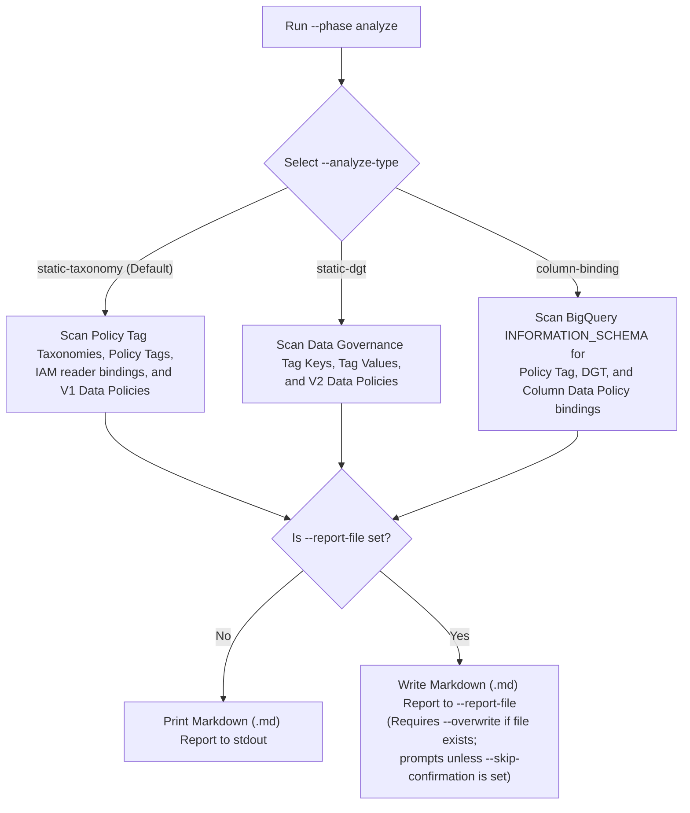

# Phase 1a: Analyze (`--phase analyze`)

**Phase Guides:** [Overview (`README.md`)](./README.md) | **Phase 1a: Analyze**
| [Phase 1b: Plan](./phase_1b_plan.md) |
[Phase 2a: Create](./phase_2a_create.md) |
[Phase 2b: Delete](./phase_2b_delete.md) |
[Phase 3: Swap & Rollback](./phase_3_swap.md) | [Changelog](./CHANGELOG.md)

This guide walks you through running `--phase analyze` to discover and audit
your existing Policy Tags, Data Governance Tags, Data Policies, and BigQuery
table column bindings before, during, and after migration.

## 1. Purpose, Scope & Decision Tree

`--phase analyze` is a **100% read-only** discovery and auditing phase. It
inspects your existing Google Cloud environment without creating, modifying, or
deleting any cloud resources or local table schemas.

`--phase analyze` supports three analysis types via `--analyze-type`:

1.  **`static-taxonomy` (Default — Pre-Migration Source Inventory):** Scans
    Policy Tag Taxonomies, Policy Tags, IAM bindings
    (`roles/datacatalog.categoryFineGrainedReader` and custom roles), and
    BigQuery V1 Data Policies (`DATA_MASKING_POLICY`,
    `COLUMN_LEVEL_SECURITY_POLICY`).
2.  **`static-dgt` (Post-Create Target DGT & V2 Policy Audit):** Scans Resource
    Manager Data Governance Tag Keys (`purpose=DATA_GOVERNANCE`), hierarchical
    Tag Values, and attached or unattached BigQuery V2 Data Policies (including
    inline IAM v3 `grantees`).
3.  **`column-binding` (Pre-/Post-Migration All-CLS Column Audit):** Queries
    regional `INFORMATION_SCHEMA.COLUMN_FIELD_PATHS` to inventory all three
    BigQuery Column-Level Security (CLS) mechanisms in one report: legacy Policy
    Tags, Data Governance Tags, and Direct Data Policies on columns.



## 2. Prerequisites & Minimum IAM Roles by Project Scope

Before running `--phase analyze`, authenticate with Application Default
Credentials (ADC) and configure your quota project:

```bash
gcloud auth login
gcloud auth application-default login
gcloud auth application-default set-quota-project <YOUR_PROJECT_ID>
```

Grant the executing principal the following read-only permissions based on the
selected `--analyze-type`:

<!-- mdformat off -->

| Analysis Type (`--analyze-type`) | Project Scope | Minimum Predefined Role(s) | Underlying Permissions | Why It Is Needed |
| :--- | :--- | :--- | :--- | :--- |
| **`static-taxonomy`** | Source Taxonomy Project (`--taxonomy-project-id`) and Custom Routine Projects | `roles/datacatalog.viewer` + `roles/datacatalog.categoryAdmin` + `roles/bigquerydatapolicy.viewer` + `roles/bigquerydatapolicy.admin` + `roles/viewer` (or `resourcemanager.projects.get`) | `datacatalog.taxonomies.list`, `datacatalog.taxonomies.get`, `datacatalog.taxonomies.getIamPolicy`, `datacatalog.policyTags.getIamPolicy`, `bigquery.dataPolicies.list`, `bigquery.dataPolicies.getIamPolicy`, `resourcemanager.projects.get` | Lists Taxonomies, Policy Tags, and V1 Data Policies, reads their IAM policies, and resolves numeric project numbers to project IDs. |
| **`static-taxonomy`** (Custom Roles) | Project / Organization | `roles/iam.roleViewer` (Project) and `roles/iam.organizationRoleViewer` (Organization) | `iam.roles.get` | Inspects permissions included in custom IAM roles (`projects/*/roles/*` or `organizations/*/roles/*`) bound to Taxonomies, Policy Tags, or V1 Data Policies. |
| **`static-dgt`** | DGT Project (`--dgt-project-id`) and V2 Data Policy Project(s) (`--data-policy-v2-project-ids`) | `roles/resourcemanager.tagViewer` (on `--dgt-project-id`) + `roles/bigquerydatapolicy.viewer` + `roles/bigquerydatapolicy.admin` (on each `--data-policy-v2-project-ids` project) | `resourcemanager.tagKeys.list`, `resourcemanager.tagValues.list`, `bigquery.dataPolicies.list`, `bigquery.dataPolicies.get`, `bigquery.dataPolicies.getIamPolicy` | Lists global `DATA_GOVERNANCE` Tag Keys and hierarchical Tag Values in `--dgt-project-id`, and lists regional V2 Data Policies (including inline `grantees`) in `--data-policy-v2-project-ids`. |
| **`column-binding`** | Data Project (`--table-project-id`), Job Project (`--execution-project`), and Taxonomy Project | `roles/bigquery.jobUser` (on execution project) + `roles/bigquery.metadataViewer` (on data project) + `roles/datacatalog.viewer` (on taxonomy project) | `bigquery.jobs.create`, `bigquery.tables.list`, `bigquery.tables.get`, `datacatalog.taxonomies.get`, `datacatalog.policyTags.get` | Queries `region-<region>.INFORMATION_SCHEMA.COLUMN_FIELD_PATHS` and resolves Policy Tag display names. |

<!-- mdformat on -->

## 3. Complete CLI Flag Reference

Run `python main.py --phase analyze` with the following flags:

<!-- mdformat off -->

| Flag | Required? | Type / Default | Description |
| :--- | :--- | :--- | :--- |
| `--phase analyze` | **Yes** | Choice (`analyze`) | Selects Phase 1a read-only analysis mode. |
| `--analyze-type` | Optional | Choice (`static-taxonomy`) | Analysis type to execute: `static-taxonomy` (default), `static-dgt`, or `column-binding`. |
| `--taxonomy-project-id` | **Yes** (`static-taxonomy`) | `str` (Singular) | Single standard Google Cloud Project ID (string ID, not numeric project number; legacy domain-scoped `example.com:project` IDs are not supported) containing the Data Catalog Policy Tag Taxonomies and V1 Data Policies to inspect. |
| `--dgt-project-id` | **Yes** (`static-dgt`) | `str` (Singular) | Single standard Google Cloud Project ID (string ID, not numeric project number; legacy domain-scoped `example.com:project` IDs are not supported) containing the global Data Governance Tag Keys and Tag Values to inspect. |
| `--data-policy-v2-project-ids` | **Yes** (`static-dgt`) | `list[str]` (1 or more) | Space-separated or comma-separated standard Google Cloud Project ID(s) where regional V2 Data Policies are queried across `--regions` and matched to the Data Governance Tags in `--dgt-project-id` (legacy domain-scoped `example.com:project` IDs are not supported). |
| `--table-project-id` | **Yes** (`column-binding`) | `str` (Singular) | Single standard Google Cloud BigQuery data project ID (string ID, not numeric project number; legacy domain-scoped `example.com:project` IDs are not supported) whose regional `INFORMATION_SCHEMA` views are scanned for column bindings. |
| `--regions` | **Yes** | `list[str]` (1 or more) | Space-separated or comma-separated region list (for example, `us eu` or `us,eu`). |
| `--verbose-bindings` | Optional | `bool` (`False`) | Lists up to 1,000 individual `dataset.table.field_path` columns bound to each tag or policy in `column-binding` mode while keeping summary counts exact (see Section 4 for truncation behavior). |
| `--execution-project` | Optional | `str` (`--table-project-id`) | Project ID used to run and bill BigQuery `INFORMATION_SCHEMA` query jobs in `column-binding` mode. |
| `--report-file` | Optional | `str` (`None`) | Local file path to save the Markdown (`.md`) analysis report. Prints to `stdout` if omitted. |
| `--log-file` | Optional | `str` (`None`) | Local file path to write timestamped execution logs (`.log`) for your engineering team to debug script runs or to share with Google Cloud Support when troubleshooting issues. |
| `--overwrite` | Optional | `bool` (`False`) | Allows overwriting existing non-empty `--report-file` or `--log-file` (prompts interactively per file unless `--skip-confirmation` is also set). |
| `--skip-confirmation` | Optional | `bool` (`False`) | Bypasses interactive file overwrite confirmation prompts when `--overwrite` is also set. |
| `--halt-on-error` | Optional | `bool` (`False`) | Exits with code `1` immediately if any scanned region encounters an API error (otherwise records regional errors in the report and exits `1` only if *all* scanned regions fail). |
| `--debug` | Optional | `bool` (`False`) | Enables `DEBUG` logging and prints full stack traces on error. |
| `--datacatalog-endpoint`, `--datapolicy-endpoint`, `--bigquery-endpoint`, `--resourcemanager-endpoint`, `--iam-endpoint` | Optional | `str` (`None`) | Custom API endpoint hostnames or `https://` URLs for Private Service Connect (PSC), mTLS (`*.mtls.googleapis.com`), or VPC Service Controls (VPC-SC) environments (note that `<region>-datacatalog.googleapis.com` does not serve Policy Tag Manager, and `<region>-bigquery.googleapis.com` requires Locational Endpoint project enrollment). |

<!-- mdformat on -->

### Exit Codes

*   **Exit Code `0`:** Returned in any of the following cases:
    *   **All scans succeeded:** Every scanned region (and every project in
        `--data-policy-v2-project-ids` for `static-dgt`) completed without API
        errors.
    *   **Partial success when `--halt-on-error` is `False` (default, flag
        omitted):** At least one scanned region/project succeeded while one or
        more other regions/projects encountered an API error. Failed scans are
        recorded inline as `[ERROR]` sections in the report while results from
        healthy regions/projects are preserved.
    *   **Overwrite prompt declined:** You answered `n` at an interactive
        `--overwrite` file confirmation prompt at startup before any scan ran.
*   **Exit Code `1`:** Returned in any of the following cases:
    *   **Total scan failure when `--halt-on-error` is `False`:** *Every*
        scanned region/project failed with an API error (zero scans succeeded).
    *   **Any scan failure when `--halt-on-error` is `True` (flag passed):**
        Stops scanning remaining regions/projects immediately upon the first
        regional API error, writes the report up to that point, and exits with
        code `1`.
    *   **Pre-scan startup or file error:** An existing output file was found
        without `--overwrite`, an output path was not writable, an interactive
        prompt was interrupted (`Ctrl+C` or closed `stdin`), or Google Cloud
        credentials failed to initialize.
*   **Exit Code `2`:** Missing required mode-specific project or `--regions`
    flags, mismatched project flags belonging to another mode or phase,
    unrecognized CLI flags, or invalid flag choices rejected by the CLI argument
    parser.

### Example CLI Invocations

**1. Static Taxonomy & V1 Policy Analysis (`static-taxonomy`, default):**

```bash
python main.py \
  --phase analyze \
  --analyze-type static-taxonomy \
  --taxonomy-project-id my-taxonomy-project \
  --regions us eu \
  --report-file static_taxonomy_report.md
```

**2. Static Data Governance Tag & V2 Policy Analysis (`static-dgt`):**

```bash
python main.py \
  --phase analyze \
  --analyze-type static-dgt \
  --dgt-project-id my-tag-project \
  --data-policy-v2-project-ids my-policy-project \
  --regions us \
  --report-file static_dgt_report.md
```

**3. Column Binding Analysis Across All CLS Mechanisms (`column-binding`):**

```bash
python main.py \
  --phase analyze \
  --analyze-type column-binding \
  --table-project-id my-data-project \
  --regions us \
  --verbose-bindings \
  --report-file column_binding_report.md
```

## 4. How Phase 1a Works (High-Level Overview)

Each `--analyze-type` inspects a distinct layer of your Column-Level Security
footprint without modifying any Google Cloud resources:

```mermaid
flowchart TD
    subgraph TaxMode["static-taxonomy (Pre-Migration Source Inventory)"]
        T1["List regional Policy Tag Taxonomies & Policy Tag hierarchies"] --> T2["Inspect resource IAM bindings & custom roles<br/>for Fine-Grained Readers"]
        T2 --> T3["List attached V1 Data Policies (Masking & Raw Access)<br/>and determine whether Access Control is enforced"]
    end

    subgraph DgtMode["static-dgt (Post-Create Target DGT & V2 Policy Audit)"]
        D1["List project Data Governance Tag Keys<br/>and reconstruct Tag Value hierarchies"] --> D2["List regional V2 Data Policies & inline grantees,<br/>and flag any unattached policies"]
    end

    subgraph BindMode["column-binding (Table & Column Coverage Audit)"]
        B1["Query regional INFORMATION_SCHEMA.COLUMN_FIELD_PATHS<br/>for overall table & column CLS coverage"] --> B2["List each Policy Tag, Data Governance Tag, and Direct Column Data Policy<br/>with its bound column count and (with --verbose-bindings) attached columns"]
    end
```



### Key Behaviors to Know

*   **How Access Control vs. Classification-Only Taxonomies Are Identified
    (`static-taxonomy`):** BigQuery enforces Column-Level Security (Default
    Deny) on a Policy Tag Taxonomy if **either** (1) `Enforce access control`
    (`FINE_GRAINED_ACCESS_CONTROL`) is explicitly enabled on the taxonomy,
    **or** (2) at least one V1 Data Policy (masking or raw access) is attached
    to any Policy Tag in that taxonomy. The report marks both cases as
    `Taxonomy Type: Access Control` (`Enforce Access Control: ON`). Taxonomies
    with neither setting are reported as `Classification Only`
    (`Enforce Access Control: OFF`, meaning BigQuery allows table readers to
    query tagged columns without fine-grained reader grants).
*   **Fine-Grained Reader, Masking & Custom Role Resolution
    (`static-taxonomy`):** The scan inspects IAM policies attached directly to
    Taxonomies, Policy Tags, and V1 Data Policies for predefined fine-grained
    access roles (`roles/datacatalog.categoryFineGrainedReader` and
    `roles/bigquerydatapolicy.maskedReader`) as well as custom Project or
    Organization IAM roles granting the equivalent permissions (annotating
    principals granted via custom roles with `(via custom role: <role_name>)`).
    The report also distinguishes explicit vs. implicit access control (`Enforce
    Access Control: ON (Implicit via attached V1 Data Policies;
    activated_policy_types=[] / Data Catalog toggle OFF)`), flags unenforced
    dangling `Fine-Grained Reader` bindings on Classification-Only taxonomies
    (`[DANGLING - NOT ENFORCED (Enforce Access Control is OFF)]`), and detects
    cross-region duplicate taxonomy display names (`Global DGT Collision: YES`).
    If a custom role cannot be read due to missing permissions, its principals
    are omitted fail-closed and an `[ACTION REQUIRED]` warning is recorded under
    `WARNINGS` at the bottom of the report (which also propagates into
    `plan.json` during `--phase plan`, blocking `--phase create` and forward
    `--phase swap` until resolved or explicitly overridden).
*   **Target DGT & V2 Data Policy Verification (`static-dgt`):** Queries global
    Tag Keys (`purpose=DATA_GOVERNANCE`) and reconstructs nested Tag Value
    hierarchies once from `--dgt-project-id` (building full slash-delimited
    hierarchical `Namespaced Name` paths
    `<project>/<key_short>/<root_short>/.../<leaf_short>` for nested child and
    grandchild Tag Values so they match `plan.json`), then scans regional V2
    Data Policies (and their inline IAM v3 `grantees`, resolving numeric project
    numbers in custom masking routines to `<project_id>.<dataset>.<routine>`)
    across each project in `--data-policy-v2-project-ids` and region in
    `--regions`, numbering Tag Keys (`1..N`) per scanned project/region section
    and matching policies back to their target Tag Keys and Tag Values. Any V2
    Data Policies in a scanned Data Policy project and region that do not attach
    to a scanned Tag Key are grouped into dedicated sections:
    `[DATA POLICIES (V2) ATTACHED TO OTHER DGT PROJECTS]` (policies referencing
    a Tag Key in a project other than `--dgt-project-id`),
    `[DIRECT COLUMN-LEVEL DATA POLICIES (V2)]` (direct column-level policies
    without a Data Governance Tag), `[CONDITION-BOUND DATA POLICIES (V2)]`
    (condition expressions `Matching Condition: ...` without a Data Governance
    Tag Key), and `[UNATTACHED DATA POLICIES (V2)]` (remaining unmatched
    policies, such as those referencing a deleted or missing tag).
*   **All-CLS Column Binding Discovery (`column-binding`):** Queries regional
    `INFORMATION_SCHEMA.COLUMN_FIELD_PATHS` to summarize how many tables and
    columns use Policy Tags (automatically excluding synthetic
    `/taxonomies/0/policyTags/` Cross-Region Replication secondary-replica
    placeholders so unpromoted secondary dataset replicas do not inflate active
    Policy Tag counts or trigger `404` Data Catalog lookups), Data Governance
    Tags, and Direct Data Policies on columns (if
    `INFORMATION_SCHEMA.COLUMN_FIELD_PATHS` in a region does not yet expose the
    `data_policies` metadata column and returns an unrecognized-column error,
    the tool skips only the direct-column Data Policy query so Policy Tag and
    Data Governance Tag binding counts still succeed). Passing
    `--verbose-bindings` displays up to 1,000 `dataset.table.column` paths per
    tag or policy so you can plan table cutover waves in Phase 3; if any tag or
    policy has more than 1,000 bound columns, the report emits an explicit
    `[NOTE]` banner and inline `[TRUNCATED: ...]` notice while `Bound Columns`
    and summary totals remain exact and untruncated.

## 5. Report Outputs & Annotated Samples

<!-- mdformat off -->

| Output | Flag | Format | Primary Audience & Purpose | Content |
| :--- | :--- | :--- | :--- | :--- |
| **Analysis Report** | `--report-file` (or `stdout`) | Markdown (`.md`) | Data governance leads, security reviewers, and platform owners auditing source Policy Tags, target DGTs/V2 Data Policies, and BigQuery column bindings. | Per-region summary metrics, hierarchical taxonomy/tag/policy inventories, bound column counts (plus up to 1,000 column paths per tag/policy with `--verbose-bindings`), and any regional or custom-role warnings. |
| **Execution Log** | `--log-file` | Plain text (`.log`) | (1) Your engineering team to debug script execution, and (2) sharing diagnostic logs with Google Cloud Support or engineering so Google can help debug issues. | Timestamped API queries, retry attempts, `INFORMATION_SCHEMA` fallback notices, and full error tracebacks (when `--debug` is set). |

<!-- mdformat on -->

All three `--phase analyze` types output a Markdown (`.md`) report containing a
top-level `#` heading followed by a fenced ```` ```text ... ``` ```` block
rendering the hierarchy and summary metrics.

### Sample 1: `static-taxonomy` Report

````markdown
# Static Taxonomy & Data Policy Analysis Report

```text
========================================================================
                        STATIC TAXONOMY ANALYSIS
========================================================================
Scan Time: 2026-03-30 22:00 UTC
Total Taxonomies Found: 1
========================================================================
------------------------------------------------------------------------
Scan of Project: my-taxonomy-project in Location: us
------------------------------------------------------------------------
------------------------------------------------------------------------
1. Taxonomy: "customer_data" (projects/my-taxonomy-project/locations/us/taxonomies/111)
------------------------------------------------------------------------
   [STATS]
    Region:                 us
    Taxonomy Type:          Access Control
    Enforce Access Control: ON
    Total Policy Tags:      2
    Total Data Policies:    1
    Taxonomy-Level Readers: 1
   [DETAILS]
   ├── Taxonomy Permission: Fine-Grained Reader (Raw Access)
   │   └── Principals: user:tax-admin@example.com
   > Policy Tag: "Public_ID" (projects/my-taxonomy-project/locations/us/taxonomies/111/policyTags/221)
   > Policy Tag: "SSN" (projects/my-taxonomy-project/locations/us/taxonomies/111/policyTags/222)
     ├── Permission: Fine-Grained Reader (Raw Access)
     │   └── Principals: user:analyst@example.com
     └── Data Policy: "mask_ssn_policy" (Rule: SHA256)
       ├── Permission: Masked Reader
       │   └── Principals: group:support@example.com
========================================================================
```
````

### Sample 2: `static-dgt` Report

````markdown
# Static Data Governance Tag (DGT) Analysis Report

```text
========================================================================
                         STATIC DGT ANALYSIS
========================================================================
Scan Time: 2026-03-30 22:00 UTC
Total DG Tag Keys Found: 1
========================================================================
------------------------------------------------------------------------
Scan of DGT Project: my-tag-project | Data Policy Project: my-policy-project in Location: us
------------------------------------------------------------------------
------------------------------------------------------------------------
1. DG Tag Key: "customer_data" (tagKeys/281474976710656)
------------------------------------------------------------------------
   [STATS]
    Namespaced Name:     my-tag-project/customer_data
    Purpose:             DATA_GOVERNANCE
    Total DG Tag Values: 1
    Total Data Policies: 2
   [DETAILS]
   > DG Tag Value: "SSN" (tagValues/281474976710658)
     ├── Namespaced Name: my-tag-project/customer_data/SSN
     └── Data Policy: "migrated_raw_customer_data_SSN_default_deny" (Type: RAW_DATA_ACCESS_POLICY)
         └── Grantees: None
     └── Data Policy: "migrated_raw_customer_data_SSN" (Type: RAW_DATA_ACCESS_POLICY)
         └── Grantees:
             - principal://goog/subject/analyst@example.com
========================================================================
```
````

### Sample 3: `column-binding` Report

````markdown
# Column-Level Security (CLS) Binding Analysis Report

```text
========================================================================
                      COLUMN BINDING ANALYSIS
========================================================================
Scan Time: 2026-03-30 22:00 UTC
========================================================================
------------------------------------------------------------------------
Project ID: my-data-project
Location:   us
------------------------------------------------------------------------
Total Tables Scanned:        10
Tables with Policy Tags:     2  (20.0%)
Total Columns/Fields:        50
Columns with Policy Tags:    2  (4.0%)
Active Policy Tags Bound:    1 (distinct tags in use)
Tables with DG Tags:         2  (20.0%)
Columns with DG Tags:        2  (4.0%)
Active DG Tags Bound:        1 (distinct tags in use)
Tables with Data Policies:   1  (10.0%)
Columns with Data Policies:  1  (2.0%)
Active Data Policies Bound:  1 (distinct policies in use)
Tables with Any CLS:         3  (30.0%)
Columns with Any CLS:        5  (10.0%)

========================================================================
[1. POLICY TAG BINDINGS]
------------------------------------------------------------------------
> Taxonomy Project: "my-taxonomy-project" (Active)
  └── Policy Tag: "SSN" (projects/12345/locations/us/taxonomies/111/policyTags/222)
      ├── Bound Columns: 2
      └── Columns:
          - finance_dataset.customers.ssn
          - hr_dataset.employees.ssn

========================================================================
[2. DATA GOVERNANCE TAG BINDINGS]
------------------------------------------------------------------------
> Tag Key: "my-tag-project/customer_data"
  └── Tag Value: "SSN"
      ├── Bound Columns: 2
      └── Columns:
          - finance_dataset.customers.ssn
          - hr_dataset.employees.ssn

========================================================================
[3. DATA POLICIES ON COLUMN]
------------------------------------------------------------------------
  └── Data Policy: "mask_ssn" (projects/12345/locations/us/dataPolicies/mask_ssn)
      ├── Bound Columns: 1
      └── Columns:
          - finance_dataset.customers.ssn
========================================================================
```
````

## 6. Scale Characteristics, Operational Guardrails & Customer Pitfalls

### Scale Characteristics

`--phase analyze` is built to run efficiently across enterprise projects with
thousands of Policy Tags, Data Policies, and BigQuery tables:

*   **Concurrent Read-Only Lookups & Automatic Retries:** Fetches resource IAM
    policies, V2 Data Policy grantees, and Policy Tag display names concurrently
    across bounded worker threads, with automatic exponential-backoff retries
    for transient rate-limit or server errors.
*   **Role & Project Metadata Caching:** Looks up custom IAM role permissions
    and project identifiers at most once per unique role or project and reuses
    the cached result across all tags and policies in the scan.
*   **Single-Pass Tag & Policy Discovery:** Fetches global Tag Keys and Tag
    Values under `--dgt-project-id` once per run—reconstructing nested
    parent-child trees in memory from a single API call per key and reusing them
    across all `--data-policy-v2-project-ids` and `--regions` scans—and hydrates
    V2 Data Policy grantee lists in parallel across all DGT-backed policies,
    including Default Deny (`_default_deny`) safety-net policies so out-of-band
    grantee drift is surfaced in `static-dgt` audits.
*   **Server-Side `INFORMATION_SCHEMA` Aggregation:** Computes table and column
    binding counts in BigQuery using regional `INFORMATION_SCHEMA` SQL queries
    rather than inspecting tables one by one, and caps `--verbose-bindings`
    display lists at 1,000 columns per tag or policy to avoid oversized query
    results while keeping summary counts exact.

### Operational Guardrails & Customer Pitfalls

*   **Inherited Project, Folder, or Organization IAM Bindings:** Resource-level
    IAM policies on Taxonomies, Policy Tags, and V1 Data Policies only include
    bindings attached directly to those resources. Principals who receive
    `datacatalog.categories.fineGrainedGet` via Project-, Folder-, or
    Organization-level IAM bindings are not returned when inspecting individual
    taxonomies or tags. Furthermore, by design, DGT V2 Data Policies evaluate
    only their inline `grantees` list and do **not** inherit or evaluate
    Organization-, Folder-, or Project-level IAM bindings. You must either
    convert those ancestor-level grants into resource-level
    `roles/datacatalog.categoryFineGrainedReader` grants on the Taxonomy or
    Policy Tag before running `--phase analyze` and `--phase plan`, or
    explicitly add those principals (or Google Groups) to your target V2 Data
    Policy `grantees` list during or after migration.
*   **Organization-Level Custom Role Visibility:** If your Policy Tags or V1
    Data Policies grant access via an Organization-level custom role
    (`organizations/<org_id>/roles/<role_id>`), the principal running
    `--phase analyze` must hold `roles/iam.organizationRoleViewer`
    (`iam.roles.get` at the Organization level). Otherwise, the tool cannot
    verify whether the custom role grants fine-grained read or masked read
    access, omits its members to stay fail-closed, and records an
    `[ACTION REQUIRED]` warning under `WARNINGS` at the bottom of the report
    (which carries into `plan.json` in `--phase plan` and blocks
    `--phase create` and forward `--phase swap` unless resolved or explicitly
    overridden with `--allow-unresolved-plan-warnings`).
*   **Single-Project Binding Discovery Scope & Cross-Region Replication
    Replicas:** `column-binding` queries `INFORMATION_SCHEMA.COLUMN_FIELD_PATHS`
    inside `--table-project-id` only and automatically filters out synthetic
    `/taxonomies/0/policyTags/` Cross-Region Replication secondary-replica
    placeholders (because legacy Policy Tags are regional and only exist in the
    dataset's primary region). Always include a replicated dataset's primary
    region in `--regions` when inspecting its Policy Tag bindings, and if tables
    in other data projects reference Policy Tags from a centralized governance
    project, run `--phase analyze --analyze-type column-binding` in each data
    project (using `--execution-project` if your billing/job project differs
    from `--table-project-id`).
*   **Next Step:** After reviewing your Phase 1a reports and resolving any
    custom-role warnings, proceed to the
    [Phase 1b Plan guide](./phase_1b_plan.md) to generate your migration plan.
