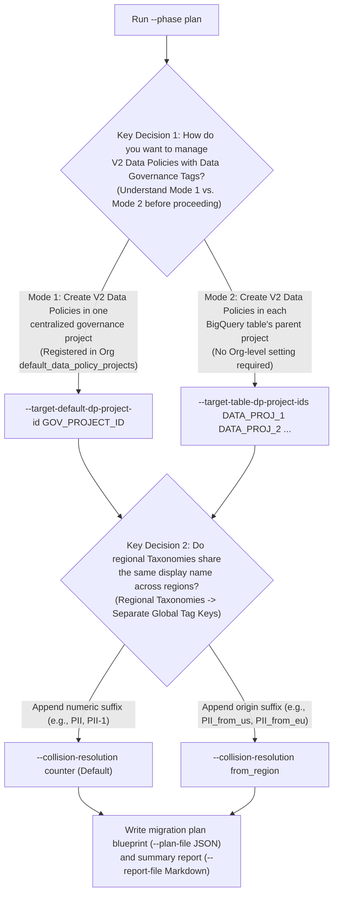
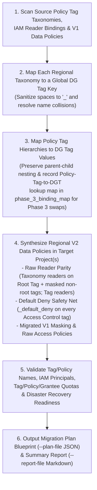

# Phase 1b: Plan (`--phase plan`)

**Phase Guides:** [Overview (`README.md`)](./README.md) |
[Phase 1a: Analyze](./phase_1a_analyze.md) | **Phase 1b: Plan** |
[Phase 2a: Create](./phase_2a_create.md) |
[Phase 2b: Delete](./phase_2b_delete.md) |
[Phase 3: Swap & Rollback](./phase_3_swap.md) | [Changelog](./CHANGELOG.md)

This guide walks you through running `--phase plan` to generate a migration plan
blueprint (`plan.json`) and a human-readable Markdown summary report mapping
your existing Policy Tags and V1 Data Policies to Data Governance Tags and V2
Data Policies.

## 1. Purpose, Scope & Decision Tree

`--phase plan` is a **100% read-only** planning phase. It scans your source
Policy Tag Taxonomies, Policy Tags, IAM bindings, and V1 Data Policies across
`--taxonomy-project-id` and `--regions`, maps them into the target Data
Governance Tag (DGT) and V2 Data Policy model, and outputs:

1.  **Migration Plan JSON (`--plan-file`):** The deterministic, machine-readable
    migration plan blueprint consumed by Phase 2a (`--phase create`), Phase 2b
    (`--phase delete`), and Phase 3 (`--phase swap`).
2.  **Markdown Summary Report (`--report-file`):** A human-readable summary
    containing source and target resource counts, target project and Disaster
    Recovery (DR) / Cross-Region Replication (CRR) guidance, five entity-mapping
    tables, and consolidated validation warnings.

**Important:** Before running `--phase plan`, review and decide on the following
two configuration choices (make sure you understand the differences between Mode
1 and Mode 2 before proceeding):

*   **How you want to manage V2 Data Policies with Data Governance Tags**—that
    is, **which Google Cloud project(s) your regional V2 Data Policies will be
    created in** (Mode 1 vs. Mode 2 below).
*   **How to resolve global Tag Key name collisions** when regional Policy Tag
    Taxonomies share the same display name across regions.



### Key Decision 1: Choosing Target V2 Data Policy Projects (Mode 1 vs. Mode 2)

While Data Governance Tag Keys and Tag Values are global resources created in
`--target-dgt-project-id`, **V2 Data Policies are regional resources**, and you
must decide which Google Cloud project(s) V2 Data Policies will be created in.

When a user queries a BigQuery table governed by Data Governance Tags, BigQuery
**only** evaluates V2 Data Policies from two locations:

1.  The **Data Table's Parent Project** (`parentProject`), and
2.  Projects registered in the Organization-level
    **`default_data_policy_projects`** setting for that region.

Because placing V2 Data Policies in any project outside those two locations
causes BigQuery to miss the policies and **fail open (Default Allow)**,
`--phase plan` requires `--target-dgt-project-id` (for global DG Tag Keys and
Values) and **exactly one** of the following V2 Data Policy project placement
modes (review both carefully before proceeding):

*   **Mode 1 — Create V2 Data Policies in One Centralized Governance Project
    (`--target-default-dp-project-id <PROJECT_ID>`, Recommended for centralized
    governance and Cross-Region Replication / Disaster Recovery):** Creates
    regional V2 Data Policies in a single centralized governance project.
    BigQuery evaluates policies from this central project across all data
    projects in your organization, and BigQuery Cross-Region Replication (CRR)
    automatically discovers and replicates V2 Data Policies from your
    organization's `default_data_policy_projects` to the secondary region when
    governed datasets are replicated—avoiding per-project policy duplication and
    drift across multiple data projects. You **must** register this project in
    your Organization's `default_data_policy_projects` setting in both your
    primary region and any DR secondary region before running Phase 3
    (`--phase swap`); see
    [Configure a default data policy project](https://cloud.google.com/bigquery/docs/tags#configure-default-data-policy-project)
    and
    [Data management settings (`default_data_policy_projects`)](https://cloud.google.com/bigquery/docs/default-configuration#data-management-settings).
*   **Mode 2 — Create V2 Data Policies in Each BigQuery Table's Parent Project
    (`--target-table-dp-project-ids <PROJECT_ID ...>`):** Creates an identical
    set of regional V2 Data Policies directly inside each specified data project
    that owns governed BigQuery tables, all referencing the shared global Data
    Governance Tags in `--target-dgt-project-id`. Requires no Organization-level
    `default_data_policy_projects` configuration, though policies are replicated
    across each listed table project.

### Key Decision 2: Resolving Tag Key Collisions (`--collision-resolution`)

**Why Collisions Happen:** Legacy Policy Tag Taxonomies are **regional**
resources, so a single source project often contains identically named
taxonomies in multiple regions (for example, a `"PII"` taxonomy in `us` for US
datasets and a `"PII"` taxonomy in `eu` for EU datasets). In contrast, Data
Governance Tag Keys are **global** resources under `--target-dgt-project-id`,
where every Tag Key short name must be unique across the entire project.

To preserve independent regional access policies and remain compatible with
BigQuery Cross-Region Replication (which fails if standalone V2 Data Policies
already exist in multiple regions for the same Tag Key), `--phase plan` maps
**each regional Policy Tag Taxonomy to its own separate global Data Governance
Tag Key**. When two regional taxonomies share the same display name (or two
taxonomies in the same region sanitize to the same name), their global Tag Key
names collide under `--target-dgt-project-id`. Choose how to disambiguate
colliding Tag Key names via `--collision-resolution`:

*   **`--collision-resolution counter` (Default):** Keeps the first Tag Key name
    clean (`PII`) and appends `-1`, `-2`, ... to colliding keys (`PII-1`), while
    recording each taxonomy's source region (`(region: us)`, `(region: eu)`) in
    the Tag Key's `description`.
*   **`--collision-resolution from_region`:** Appends `_from_<region>` to all
    colliding keys (`PII_from_us`, `PII_from_eu`). Using `_from_<region>`
    clearly indicates historical migration origin rather than a geographic
    restriction on the global tag.

If neither `counter` nor `from_region` fits your organization's naming
conventions (and manual customization in `plan.json` is not practical at your
scale), reach out to your Google Cloud account team, Google Cloud Support, or
open an issue in the repository to request additional collision-resolution
strategies.

#### Why Regional Taxonomies Are Not Consolidated into a Single Global DG Tag Key

By design, `--phase plan` keeps each regional Policy Tag Taxonomy as its own
separate global DG Tag Key rather than merging identically named regional
taxonomies (`us`, `eu`, etc.) into one shared Tag Key:

*   **Avoiding Cross-Region Replication (CRR) Policy Conflicts:** When you
    replicate a dataset across regions using BigQuery CRR, BigQuery rejects
    policy replication if the secondary region already contains standalone V2
    Data Policies attached to the same DG Tag Key as the primary region's
    policies. Consolidating `us` and `eu` taxonomies onto one Tag Key with
    standalone policies in both regions would block future CRR between those
    regions.
*   **Preventing Fail-Open Security Gaps During Migration:** If policies for a
    consolidated Tag Key were created in only one primary region and relied on
    CRR to copy them to secondary regions, swapping columns in a secondary
    region to the DGT before CRR finishes replicating policies would leave those
    columns with zero local V2 Data Policies—exposing sensitive data as Default
    Allow (Fail-Open).
*   **Avoiding Cross-Region Migration & Operational Complexity:** Relying on CRR
    during migration would couple tag and policy provisioning to dataset
    replication schedules and asynchronous replication state across regions,
    significantly increasing operational risk and troubleshooting complexity.
*   **Preserving Independent Regional Governance:** Because legacy Policy Tags
    do not support CRR, identically named taxonomies in different regions today
    govern independent primary datasets that often have distinct regional
    readers or masking rules. Separate global Tag Keys preserve each region's
    exact access posture cleanly.
*   **Need Multi-Region Consolidation?** If your governance model requires
    consolidating regional taxonomies into a single global DG Tag Key, contact
    your Google Cloud account team, Google Cloud Support, or open a repository
    issue to share your use case.

## 2. Prerequisites & Minimum IAM Roles by Project Scope

Authenticate with Application Default Credentials (ADC) before running
`--phase plan`:

```bash
gcloud auth login
gcloud auth application-default login
gcloud auth application-default set-quota-project <YOUR_PROJECT_ID>
```

Because `--phase plan` scans your existing Policy Tag taxonomies, IAM bindings,
and V1 Data Policies to build the migration plan, grant the executing principal
the following read-only permissions on the source taxonomy project (and on
custom routine projects or Organization custom roles, if applicable):

<!-- mdformat off -->

| Scope | Minimum Predefined Role(s) | Underlying Permissions | Why It Is Needed |
| :--- | :--- | :--- | :--- |
| **Source Taxonomy Project (`--taxonomy-project-id`)** | `roles/datacatalog.viewer` + `roles/datacatalog.categoryAdmin` | `datacatalog.taxonomies.list`, `datacatalog.taxonomies.get`, `datacatalog.taxonomies.getIamPolicy`, `datacatalog.policyTags.getIamPolicy` | Reads source Taxonomies, Policy Tags, and IAM policies (`fineGrainedReader`). |
| **Source Taxonomy Project (`--taxonomy-project-id`)** | `roles/bigquerydatapolicy.viewer` + `roles/bigquerydatapolicy.admin` | `bigquery.dataPolicies.list`, `bigquery.dataPolicies.getIamPolicy` | Reads source V1 Data Policies and their IAM policies (`maskedReader`). |
| **Source Taxonomy Project & Custom Routine Projects** | `roles/viewer` or `roles/browser` (`resourcemanager.projects.get`) | `resourcemanager.projects.get` | Resolves numeric project numbers in taxonomy names and custom masking routine paths into project IDs. |
| **Project / Organization Custom Roles (Optional)** | `roles/iam.roleViewer` (Project) and `roles/iam.organizationRoleViewer` (Organization) | `iam.roles.get` | Inspects permissions included in custom IAM roles bound to source Taxonomies, Policy Tags, or V1 Data Policies. |

<!-- mdformat on -->

## 3. Complete CLI Flag Reference

Run `python main.py --phase plan` with the following flags:

<!-- mdformat off -->

| Flag | Required? | Type / Default | Description |
| :--- | :--- | :--- | :--- |
| `--phase plan` | **Yes** | Choice (`plan`) | Selects Phase 1b read-only migration planning mode. |
| `--taxonomy-project-id` | **Yes** | `str` (Singular) | Single standard source Google Cloud Project ID (string ID, not numeric project number; legacy domain-scoped `example.com:project` IDs are not supported) containing the Policy Tag Taxonomies and V1 Data Policies to migrate. |
| `--regions` | **Yes** | `list[str]` (1 or more) | Space-separated or comma-separated list of source regions to scan (for example, `us eu` or `us,eu`). |
| `--target-dgt-project-id` | **Yes** | `str` (Singular) | Single standard target Google Cloud Project ID where global Data Governance Tag Keys and Tag Values (`purpose=DATA_GOVERNANCE`) will be created (legacy domain-scoped `example.com:project` IDs are not supported). |
| `--target-default-dp-project-id` | **Yes (Mode 1)** | `str` (Mutually exclusive with Mode 2) | Mode 1 (V2 Data Policy Placement — Centralized Governance Project): Single standard target project ID (registered in Organization-level `default_data_policy_projects`; legacy domain-scoped `example.com:project` IDs are not supported) where regional V2 Data Policies will be created. |
| `--target-table-dp-project-ids` | **Yes (Mode 2)** | `list[str]` (Mutually exclusive with Mode 1) | Mode 2 (V2 Data Policy Placement — Table Parent Projects): One or more standard BigQuery data table parent project IDs where regional V2 Data Policies will be created (space- or comma-separated; legacy domain-scoped `example.com:project` IDs are not supported). |
| `--collision-resolution` | Optional | Choice: `counter` \| `from_region` (`counter`) | Strategy when multiple regional Taxonomies sanitize to the same DG Tag Key short name: `counter` appends `-1`, `-2` to colliding keys; `from_region` appends `_from_<region>` to all colliding keys. Both record `(region: <region>)` in `description`. |
| `--plan-file` | Optional | `str` (`None`) | Output path for the JSON migration plan blueprint. Prints JSON to `stdout` if omitted. |
| `--report-file` | Optional | `str` (`None`) | Output path for the Markdown migration plan summary report. Prints Markdown to `stdout` if omitted. |
| `--log-file` | Optional | `str` (`None`) | Local file path to write timestamped execution logs (`.log`) for your engineering team to debug script runs or to share with Google Cloud Support when troubleshooting issues. |
| `--overwrite` | Optional | `bool` (`False`) | Allows overwriting existing non-empty `--plan-file`, `--report-file`, or `--log-file` (prompts interactively per file unless `--skip-confirmation` is also set). |
| `--skip-confirmation` | Optional | `bool` (`False`) | Bypasses interactive file overwrite confirmation prompts when `--overwrite` is also set. |
| `--halt-on-error` | Optional | `bool` (`False`) | Aborts plan generation and exits with code `1` if any scanned region encounters a static taxonomy analysis error. |
| `--debug` | Optional | `bool` (`False`) | Enables `DEBUG` logging and prints full stack traces on error. |
| `--datacatalog-endpoint`, `--datapolicy-endpoint`, `--resourcemanager-endpoint`, `--iam-endpoint` | Optional | `str` (`None`) | Custom API endpoint hostnames or `https://` URLs for Private Service Connect (PSC), mTLS (`*.mtls.googleapis.com`), or VPC Service Controls (VPC-SC) environments (note that `--datacatalog-endpoint` requires a global, mTLS, or PSC Data Catalog endpoint rather than `<region>-datacatalog.googleapis.com`, which does not serve Policy Tag Manager). |

<!-- mdformat on -->

### Exit Codes

*   **Exit Code `0`:** Plan JSON and Markdown summary report were generated
    successfully (including partial multi-region scans where at least one region
    succeeded when `--halt-on-error` is `False`, default), or you answered `n`
    at an interactive `--overwrite` file confirmation prompt at startup before
    any scan ran.
*   **Exit Code `1`:** Every scanned region failed static taxonomy analysis when
    `--halt-on-error` is `False`, any scanned region failed when
    `--halt-on-error` is `True`, an interactive `--overwrite` prompt was
    interrupted (`Ctrl+C` or closed `stdin`), or a pre-scan startup or
    file-write error occurred (such as an existing output file without
    `--overwrite`, an unwritable output path, or missing Google Cloud
    credentials).
*   **Exit Code `2`:** Missing or invalid CLI arguments rejected by the CLI
    argument parser (for example, omitting `--target-dgt-project-id` or
    specifying neither / both Mode 1 and Mode 2 target Data Policy project
    flags).

### Example CLI Invocations

**Mode 1 (Create V2 Data Policies in One Centralized Governance Project
Registered in `default_data_policy_projects`):**

```bash
python main.py \
  --phase plan \
  --taxonomy-project-id my-taxonomy-project \
  --regions us-central1 eu \
  --target-dgt-project-id central-dgt-project \
  --target-default-dp-project-id central-dp-project \
  --collision-resolution counter \
  --plan-file migration_plan.json \
  --report-file plan_summary.md
```

**Mode 2 (Create V2 Data Policies in Each BigQuery Table's Parent Project):**

```bash
python main.py \
  --phase plan \
  --taxonomy-project-id my-taxonomy-project \
  --regions us-central1 eu \
  --target-dgt-project-id central-dgt-project \
  --target-table-dp-project-ids data-project-1 data-project-2 \
  --collision-resolution from_region \
  --plan-file migration_plan.json \
  --report-file plan_summary.md
```

## 4. How Phase 1b Builds Your Migration Plan (High-Level Overview)



### Key Mapping Rules & Design Decisions

#### 1. 1-to-1 Regional Taxonomy Mapping & Name Sanitization

*   **Separate Global Tag Key per Regional Taxonomy:** Every regional Taxonomy
    maps 1-to-1 to its own global DG Tag Key in `--target-dgt-project-id`
    (resolving cross-region name collisions via the `--collision-resolution`
    flag: `counter` or `from_region`; see
    [Why Regional Taxonomies Are Not Consolidated into a Single Global DG Tag Key](#why-regional-taxonomies-are-not-consolidated-into-a-single-global-dg-tag-key)
    above).
*   **Transparent Tag Name Formatting:** Spaces in Taxonomy and Policy Tag
    display names are replaced with underscores (`_`) while preserving original
    casing. Tag Key and Tag Value short names must be 1–63 characters, start and
    end with an ASCII letter or digit, and use only `[a-zA-Z0-9._-]`. Instead of
    silently truncating or stripping characters, any non-compliant name receives
    an `[ACTION REQUIRED]` warning so you can update the invalid name in
    `plan.json` (following the cross-field update steps in Section 6) before
    running Phase 2a.
*   **Hierarchical Tag Values & Taxonomy-Wide Short-Name Uniqueness:**
    Parent-child Policy Tag hierarchies are preserved in top-down order so
    parent Tag Values are always created before child Tag Values in Phase 2a.
    Because V2 Data Policies reference a Tag Value by its short name under the
    Tag Key, duplicate Tag Value short names within the same taxonomy—for
    example, child tags with the same display name under different branches
    (`Customer > Email` and `Employee > Email`) or sibling display names that
    sanitize to the same string (`"PII ID"` and `"PII_ID"` both becoming
    `PII_ID`)—are automatically disambiguated with `-1`, `-2` (`Email-1`,
    `PII_ID-1`).

#### 2. Preserving Security Posture with V2 Data Policies

Unlike Access Control Policy Tags (which lock down columns automatically), Data
Governance Tags are **Fail-Open (Default Allow)** whenever a Tag Value has no
attached V2 Data Policy. For every Access Control taxonomy, the plan creates up
to three categories of regional V2 Data Policies in your chosen target Data
Policy project(s) (your single Mode 1 governance project, or each Mode 2 table
parent project):

1.  **Raw Reader Parity Policies (`Raw Reader Parity`):**
    *   **Taxonomy-Level Readers (Root Tag Values + Masked Non-Root Tag
        Values):** Principals granted `fineGrainedReader` at the Taxonomy level
        are placed on a `RAW_DATA_ACCESS_POLICY` attached to the **Root Tag
        Value(s)** of that taxonomy—and are **also copied onto any non-root Tag
        Value that carries a direct `DATA_MASKING_POLICY`**.
        *   *Why PT and DGT Differ Under Child Masking:* In legacy Policy Tags,
            every Policy Tag inherits IAM bindings directly from its parent
            Taxonomy, so if a principal (for example, via a group) holds both
            Taxonomy-level `Fine-Grained Reader` and a child Policy Tag's
            `Masked Reader` role, BigQuery evaluates both at the leaf Policy Tag
            and **unmasked (`RAW`) access wins**. In Data Governance Tags (V2),
            BigQuery evaluates policies at the **deepest matching tag in the
            hierarchy first** (`RAW` beats `MASKED` only at the same tag depth):
            if taxonomy-level readers existed only on the Root Tag Value (depth
            `1`) while a child Tag Value (depth `2`) had a
            `DATA_MASKING_POLICY`, a user in both groups would match at depth
            `2` and receive **masked** data instead of unmasked data.
        *   *How `--phase plan` Preserves Exact Parity:* Unmasked child Tag
            Values inherit taxonomy-level raw access cleanly from the Root Tag
            Value via `column.matchTagHierarchy` without duplicate policies,
            while any non-root Tag Value that has a direct masking policy
            automatically receives taxonomy-level readers in its own
            `RAW_DATA_ACCESS_POLICY` so those readers continue seeing unmasked
            data just as they did with Policy Tags. (Note: readers granted on a
            *parent Policy Tag* rather than the Taxonomy are overridden by child
            masking in both Policy Tags and DGT, so parent-tag readers are kept
            solely on that parent Tag Value.)
    *   **Policy-Tag-Level Readers:** Principals granted `fineGrainedReader` on
        a specific Policy Tag receive a `RAW_DATA_ACCESS_POLICY` on that Tag
        Value (`migrated_raw_<key>_<value>`).
2.  **Fail-Closed Default Deny Safety-Net Policies (`Default Deny Parity`):**
    *   Every Policy Tag in an Access Control taxonomy receives a dedicated
        `RAW_DATA_ACCESS_POLICY` with an empty grantee list (`grantees: []`) and
        ID `migrated_raw_<key>_<value>_default_deny`. Even when a Tag Value also
        has a Raw Reader or Masking policy, this `_default_deny` safety-net
        policy ensures that deleting a reader or masking policy later never
        causes the column to fall open to general table readers.
3.  **Migrated V1 Data Policies:**
    *   Existing V1 Data Masking policies are mapped to V2 `DATA_MASKING_POLICY`
        resources (`migrated_masking_...`) preserving their predefined masking
        expression or custom masking UDF routine and masked readers. Existing V1
        Column-Level Security / Raw Data Access policies are mapped to V2
        `RAW_DATA_ACCESS_POLICY` resources (`migrated_raw_...`) preserving their
        raw data readers.

#### 3. Policy ID, Principal & Disaster Recovery Readiness Checks

*   **Policy ID, Principal & Custom-Routine Conflict Validation:** V2 Data
    Policy IDs use only letters, numbers, and underscores (`_`) up to 200
    characters (appending `_1`, `_2` on collisions within the same project and
    region). Source IAM principals are translated automatically to IAM v3
    grantee format (`user:...` to `principal://goog/subject/...`, `group:...` to
    `principalSet://goog/group/...`, and `serviceAccount:...` to
    `principal://iam.googleapis.com/projects/-/serviceAccounts/...`). Overlong
    policy IDs, unresolved custom routine project numbers
    (`<unknown-project-...>`), cross-project custom masking routines (where
    `data_masking_policy.routine` resides in a project different from the V2
    Data Policy's `target_project_id`), overlapping non-raw grantees across
    multiple custom masking routine policies on the same Tag Value (which cause
    BigQuery queries to fail closed with "Found multiple conflicting data
    policies with custom masking expressions."), deleted accounts
    (`deleted:...`), unsupported principals (`domain:...`, `allUsers`,
    `allAuthenticatedUsers`, or BigQuery Authorized Routines containing
    `/routines/`), and V2 Data Policies exceeding `500` distinct IAM principals
    or `100` distinct `principalSet://` group principals are flagged with
    `[ACTION REQUIRED]` warnings that block `--phase create` and forward
    `--phase swap` (`pt-to-dgt`) by default until resolved in `plan.json` (or
    explicitly overridden via `--allow-unresolved-plan-warnings`).
*   **Resource Quotas, Authorized Views & Cross-Region Replication Readiness:**
    Checks that planned resources stay within Google Cloud's limits of `1,000`
    Tag Keys per `--target-dgt-project-id` project, `1,000` Tag Values per Tag
    Key, and `1,000` V2 Data Policies per `(Project, Region, DG Tag Key)`
    (attaching `[ACTION REQUIRED]` warnings when `1,000` Tag Keys or `1,000` Tag
    Values are exceeded), reminds Mode 1 (`--target-default-dp-project-id`)
    operators that Organization `default_data_policy_projects` accepts at most
    `1` project per region, warns when source bindings include Authorized Views
    or Authorized Datasets (`DR_WARN_04`: V2 Data Policies on Data Governance
    Tags do **not** delegate column access through Authorized Views or
    Authorized Datasets, so querying end users/groups must be granted access
    directly in `grantees`), and adds Cross-Region Replication readiness
    reminders when policies reference custom masking routines (`DR_WARN_03`) or
    span multiple regions on the same Tag Key (`DR_WARN_01`).

## 5. Migration Plan Blueprint & Sample Outputs

<!-- mdformat off -->

| Output | Flag | Format | Primary Audience & Purpose | Content |
| :--- | :--- | :--- | :--- | :--- |
| **Migration Plan Blueprint** | `--plan-file` (or `stdout`) | JSON (`.json`) | Machine-readable migration plan blueprint consumed by Phase 2a (`--phase create`), Phase 2b (`--phase delete`), and Phase 3 (`--phase swap`). | `metadata`, `plan_summary`, `phase_2_resource_manifest` (Tag Keys, Tag Values, and V2 Data Policy creation payloads), `phase_3_binding_map` (Policy-Tag-to-DGT lookup table), and validation warnings. |
| **Plan Summary Report** | `--report-file` (or `stdout`) | Markdown (`.md`) | Data governance leads, security reviewers, and platform owners reviewing planned Tag Keys, Tag Values, V2 Data Policies, DR guidance, and validation warnings before creating resources. | Source and target metrics, target project & DR readiness guidance, 5 entity-mapping tables (with source region, collision resolution, and IAM provenance notes), and `### Warnings` plus an automatic `#### Warning & Error Code Reference` explaining each warning code. |
| **Execution Log** | `--log-file` | Plain text (`.log`) | (1) Your engineering team to debug script execution, and (2) sharing diagnostic logs with Google Cloud Support or engineering so Google can help debug issues. | Timestamped API queries, retry attempts, planning progress, and detailed error diagnostics and stack traces (when `--debug` is set). |

<!-- mdformat on -->

### Sample 1: `plan.json` Migration Plan Blueprint

`plan.json` contains four top-level sections (`metadata`, `plan_summary`,
`phase_2_resource_manifest`, and `phase_3_binding_map`, plus optional top-level
`warnings` if any region failed static analysis):

```json
{
  "metadata": {
    "schema_version": 1,
    "source_project_id": "my-taxonomy-project",
    "target_dgt_project_id": "central-dgt-project",
    "target_data_policy_mode": "DEFAULT_DATA_POLICY_PROJECT",
    "target_data_policy_project_ids": [
      "central-dp-project"
    ],
    "collision_resolution": "counter",
    "source_regions": [
      "us"
    ],
    "generation_timestamp": "2026-03-30T22:00:00+00:00",
    "tool_version": "1.0.0",
    "description": "Migration plan from Policy Tags to Data Governance Tags"
  },
  "plan_summary": {
    "total_taxonomies_mapped": 1,
    "total_tags_to_create": 1,
    "total_policies_to_create": 3,
    "scope": "PROJECT_LEVEL",
    "source_metrics": {
      "total_taxonomies": 1,
      "total_policy_tags": 1,
      "total_data_policies": 1
    },
    "target_metrics": {
      "total_tag_keys": 1,
      "total_tag_values": 1,
      "total_data_policies": 3,
      "total_raw_reader_policies": 1,
      "total_default_deny_policies": 1,
      "total_migrated_data_policies": 1
    }
  },
  "phase_2_resource_manifest": {
    "comment": "Resource manifest for Phase 2. Contains lists of creation actions for Tag Keys, Tag Values, and Data Policies.",
    "taxonomies_to_dg_tag_keys": [
      {
        "namespaced_name": "central-dgt-project/Sensitive_Data",
        "action": "CREATE_DG_TAG_KEY",
        "api_payload": {
          "short_name": "Sensitive_Data",
          "parent": "projects/central-dgt-project",
          "purpose": "DATA_GOVERNANCE",
          "description": "Migrated from Taxonomy: Sensitive Data (region: us)"
        },
        "source_resource_name": "projects/my-taxonomy-project/locations/us/taxonomies/111",
        "source_display_name": "Sensitive Data",
        "source_taxonomy_region": "us",
        "audit_lineage": "Migrated from Taxonomy: Sensitive Data (region: us) | Source taxonomy: projects/my-taxonomy-project/locations/us/taxonomies/111"
      }
    ],
    "policy_tags_to_dg_tag_values": [
      {
        "namespaced_name": "central-dgt-project/Sensitive_Data/SSN",
        "action": "CREATE_DG_TAG_VALUE",
        "parent_namespaced_name": "central-dgt-project/Sensitive_Data",
        "api_payload": {
          "short_name": "SSN",
          "description": "Migrated from Policy Tag: Sensitive Data > SSN"
        },
        "source_resource_name": "projects/my-taxonomy-project/locations/us/taxonomies/111/policyTags/222",
        "source_display_path": "Sensitive Data > SSN",
        "source_taxonomy_name": "projects/my-taxonomy-project/locations/us/taxonomies/111",
        "source_taxonomy_region": "us",
        "audit_lineage": "Migrated from Policy Tag: Sensitive Data > SSN | Source policy tag: projects/my-taxonomy-project/locations/us/taxonomies/111/policyTags/222"
      }
    ],
    "policy_tags_to_raw_reader_data_policies_v2": [
      {
        "policy_id": "migrated_raw_Sensitive_Data_SSN",
        "action": "CREATE_DATA_POLICY_V2",
        "type": "RAW_DATA_ACCESS_POLICY",
        "region": "us",
        "target_project_id": "central-dp-project",
        "dg_tag_value_namespaced_name": "central-dgt-project/Sensitive_Data/SSN",
        "api_payload": {
          "data_policy_type": "RAW_DATA_ACCESS_POLICY",
          "data_policy_id": "migrated_raw_Sensitive_Data_SSN",
          "data_governance_tag": {
            "key": "central-dgt-project/Sensitive_Data",
            "value": "SSN"
          },
          "grantees": [
            "principal://goog/subject/analyst@example.com"
          ]
        },
        "source_resource_name": "projects/my-taxonomy-project/locations/us/taxonomies/111/policyTags/222",
        "source_display_path": "Sensitive Data > SSN",
        "source_entity_type": "Policy Tag",
        "note": "Raw Reader Parity",
        "audit_lineage": "Migrated from Policy Tag: Sensitive Data > SSN (Raw Reader Parity)"
      }
    ],
    "policy_tags_to_default_deny_data_policies_v2": [
      {
        "policy_id": "migrated_raw_Sensitive_Data_SSN_default_deny",
        "action": "CREATE_DATA_POLICY_V2",
        "type": "RAW_DATA_ACCESS_POLICY",
        "region": "us",
        "target_project_id": "central-dp-project",
        "dg_tag_value_namespaced_name": "central-dgt-project/Sensitive_Data/SSN",
        "api_payload": {
          "data_policy_type": "RAW_DATA_ACCESS_POLICY",
          "data_policy_id": "migrated_raw_Sensitive_Data_SSN_default_deny",
          "data_governance_tag": {
            "key": "central-dgt-project/Sensitive_Data",
            "value": "SSN"
          },
          "grantees": []
        },
        "source_resource_name": "projects/my-taxonomy-project/locations/us/taxonomies/111/policyTags/222",
        "source_display_path": "Sensitive Data > SSN",
        "source_entity_type": "Policy Tag",
        "note": "Default Deny Parity",
        "audit_lineage": "Migrated from Policy Tag: Sensitive Data > SSN (Default Deny Parity)"
      }
    ],
    "data_policies_v1_to_data_policies_v2": [
      {
        "policy_id": "migrated_masking_Sensitive_Data_custom_masking",
        "action": "CREATE_DATA_POLICY_V2",
        "type": "DATA_MASKING_POLICY",
        "region": "us",
        "target_project_id": "central-dp-project",
        "dg_tag_value_namespaced_name": "central-dgt-project/Sensitive_Data/SSN",
        "api_payload": {
          "data_policy_type": "DATA_MASKING_POLICY",
          "data_policy_id": "migrated_masking_Sensitive_Data_custom_masking",
          "data_governance_tag": {
            "key": "central-dgt-project/Sensitive_Data",
            "value": "SSN"
          },
          "data_masking_policy": {
            "predefined_expression": "SHA256"
          },
          "grantees": [
            "principalSet://goog/group/support@example.com"
          ]
        },
        "source_resource_name": "projects/my-taxonomy-project/locations/us/dataPolicies/custom_masking",
        "source_display_path": "Sensitive Data > SSN > custom_masking",
        "source_entity_type": "DATA_MASKING_POLICY",
        "audit_lineage": "Migrated from Data Policy: Sensitive Data > SSN > custom_masking (DATA_MASKING_POLICY)"
      }
    ]
  },
  "phase_3_binding_map": {
    "comment": "Lookup table for Phase 3. Keys are Policy Tag Resource Names; Values are Target DGT Identifiers.",
    "policy_tags_to_dg_tag_values": {
      "projects/my-taxonomy-project/locations/us/taxonomies/111/policyTags/222": {
        "dg_tag_key": "central-dgt-project/Sensitive_Data",
        "dg_tag_value": "SSN"
      }
    }
  }
}
```

### Sample 2: Companion Markdown Summary Report (`--report-file`)

For the `plan.json` blueprint above, `--report-file` writes the following
human-readable Markdown summary report (ending with `### Warnings` and a
`#### Warning & Error Code Reference` subsection explaining each encountered
warning code):

```markdown
# Policy Tag to Data Governance Tag Migration Plan Summary

- **Source Project:** my-taxonomy-project (Project with existing Policy Tags)
- **Source Region(s):** us
- **Target DG Tag Project:** central-dgt-project (Project where global Data Governance Tag Keys and Values will be created)
- **Target Data Policy Placement Mode:** DEFAULT_DATA_POLICY_PROJECT
- **Target Data Policy Project(s):** central-dp-project (Project(s) where regional V2 Data Policies will be created)
- **Tag Key Collision Resolution Strategy:** counter

### Target Project Architecture & Disaster Recovery Readiness

- **Global Data Governance Tag Project (`--target-dgt-project-id`):** `central-dgt-project`
- **Data Policy Placement Mode (`--target-default-dp-project-id` - Mode 1):** `central-dp-project` (Organization-Level Default Data Policy Project)
  - **Action Required for Query Evaluation & Disaster Recovery [DR_WARN_02]:**
    - **Why:** BigQuery evaluates and replicates V2 Data Policies only from a table's parent project (`parentProject`) or projects configured in your Organization's `default_data_policy_projects` setting.
    - **Required Action:** Register `central-dp-project` in `default_data_policy_projects` in **both** your primary region(s) (us) and any target Disaster Recovery (Cross-Region Replication) secondary regions before switching enforcement or enabling dataset replication.

#### Multi-Region Taxonomy Separation & Disaster Recovery (Customer Feedback Welcome)
- **Regional-to-Global Tag Key Mapping:** By design, this migration tool maps each regional Policy Tag taxonomy to its own separate global Data Governance Tag Key (resolving cross-region naming collisions using `-1`, `-2` by default or `_from_<region>` via `--collision-resolution from_region`, and recording the source region in the Tag Key's description) rather than consolidating taxonomies across regions.
- **Cross-Region Replication (DR) Safety:** Because legacy Policy Tags do not support Cross-Region Replication, existing taxonomies in different regions govern independent primary datasets. Keeping their migrated Tag Keys separate preserves independent regional access control policies and ensures that when you enable BigQuery Cross-Region Replication (Disaster Recovery) after migration, the primary region's Data Policies can replicate cleanly to the secondary region without conflicting with pre-existing standalone policies in the secondary region.
- **Feedback Welcome:** If this Separation-Only design decision does not meet your governance needs (for example, if you need automated cross-region taxonomy consolidation), please share feedback with the BigQuery team via your Google Cloud account team, Cloud Support, or by opening an issue in the repository.

### Source Metrics (Existing Policy Tags to be migrated)
- **Total Taxonomies:** 1
- **Total Policy Tags:** 1
- **Total Data Policies:** 1

### Target Metrics (New Data Governance Tags to be created)
- **Total Tag Keys to Create:** 1
- **Total Tag Values to Create:** 1
- **Total Data Policies to Create:** 3
  - **Raw Reader Parity Policies:** 1
  - **Default Deny Parity Policies:** 1
  - **Migrated V1 Data Policies:** 1

## Proposed Entity Mapping

### 1. Taxonomies to DG Tag Keys

<!-- mdformat off -->
| Source Entity Type | Source Entity | -> | Target Entity Type | Target Entity | Note |
| :--- | :--- | :--- | :--- | :--- | :--- |
| Taxonomy | Sensitive Data | -> | DG Tag Key | central-dgt-project/Sensitive_Data | Source region: us |
<!-- mdformat on -->

### 2. Policy Tags to DG Tag Values

<!-- mdformat off -->
| Source Entity Type | Source Entity | -> | Target Entity Type | Target Entity | Note |
| :--- | :--- | :--- | :--- | :--- | :--- |
| Policy Tag | Sensitive Data > SSN | -> | DG Tag Value | central-dgt-project/Sensitive_Data/SSN | |
<!-- mdformat on -->

### 3. Policy Tags to Data Policies (V2) - Raw Reader Parity

#### Why Raw Reader Parity Policies Are Created
- **Legacy Policy Tag Raw Reader Model:** In the legacy Policy Tag model, read access to raw (unmasked) data for columns governed by an Access Control taxonomy is granted to principals via the predefined `roles/datacatalog.categoryFineGrainedReader` role or custom project/organization IAM roles granting `datacatalog.categories.fineGrainedGet`, assigned directly on Policy Tags or at the Taxonomy level.
- **V2 Data Policy Mapping & Provenance:** Because Data Governance Tags (DGT) do not use tag-level IAM roles to grant column data access, the migration planner synthesizes an explicit V2 Data Policy of type `RAW_DATA_ACCESS_POLICY` bound to the corresponding DG Tag Value and migrates the original fine-grained reader principals into the policy's `grantees` list, ensuring continuous, uninterrupted raw data access for authorized users:
  - **Policy Tag-Level IAM (`from Policy Tag IAM`):** Synthesizes a `RAW_DATA_ACCESS_POLICY` directly on the corresponding DG Tag Value for each Policy Tag with direct fine-grained readers.
  - **Taxonomy-Level IAM (`from Taxonomy IAM` / `from Policy Tag & Taxonomy IAM`):** Maps taxonomy-level fine-grained reader permissions onto the Root Tag Value(s) of the taxonomy and onto any non-root Tag Value that carries a direct masking policy (so principals holding both taxonomy-level raw access and child-level masked access retain unmasked access under DGT's deepest-tag precedence rule, matching Policy Tag behavior), while unmasked descendant tag values inherit access via `column.matchTagHierarchy`.

<!-- mdformat off -->
| Source Entity Type | Source Entity | -> | Target Entity Type | Target Entity | Note |
| :--- | :--- | :--- | :--- | :--- | :--- |
| Policy Tag | Sensitive Data > SSN | -> | Data Policy V2 | central-dp-project/migrated_raw_Sensitive_Data_SSN | Raw Reader Parity (from Policy Tag IAM) |
<!-- mdformat on -->

### 4. Policy Tags to Data Policies (V2) - Default Deny Parity

#### Why Default Deny Parity Policies Are Created
- **Fail-Closed vs. Fail-Open Posture:**
  - **Legacy Policy Tags - Fail-Closed (Default Deny):** Taxonomies with Access Control enabled automatically lock down tagged columns, denying anyone without explicit permissions.
  - **Data Governance Tags - Fail-Open (Default Allow) Without a Data Policy:** Attaching a Data Governance Tag without an associated Data Policy grants access to anyone with table-level read permissions.
- **Defense-in-Depth Default Deny Policy:** To preserve an equivalent Fail-Closed lockdown posture, the migration planner establishes an immutable defense-in-depth safety net by creating a Default Deny Parity policy (`_default_deny`, `grantees: []`) for every single Tag Value in an access-controlled taxonomy, regardless of whether that tag also has explicit raw reader or data masking policies:
  - **Lockdown Without Explicit Readers:** Policy tags with no explicit readers remain strictly locked down.
  - **Protection Against Policy Deletion:** If an administrator or automated pipeline later deletes a parent or direct raw reader policy, descendant columns remain Fail-Closed rather than silently falling open to all table readers.

<!-- mdformat off -->
| Source Entity Type | Source Entity | -> | Target Entity Type | Target Entity | Note |
| :--- | :--- | :--- | :--- | :--- | :--- |
| Policy Tag | Sensitive Data > SSN | -> | Data Policy V2 | central-dp-project/migrated_raw_Sensitive_Data_SSN_default_deny | Default Deny Parity |
<!-- mdformat on -->

### 5. Data Policies (V1) to Data Policies (V2)

<!-- mdformat off -->
| Source Entity Type | Source Entity | -> | Target Entity Type | Target Entity | Note |
| :--- | :--- | :--- | :--- | :--- | :--- |
| Data Policy (DATA_MASKING_POLICY) | Sensitive Data > SSN > custom_masking | -> | Data Policy V2 | central-dp-project/migrated_masking_Sensitive_Data_custom_masking | |
<!-- mdformat on -->

### Warnings

- None

#### Warning & Error Code Reference

- **`DR_WARN_02`:** Target Data Policy project lookup and Disaster Recovery readiness reminder.
  - **Mode 1 (`--target-default-dp-project-id`):** Register the central Data Policy project in Organization-level `default_data_policy_projects` in **both** primary and DR secondary regions before `--phase swap`.
  - **Mode 2 (`--target-table-dp-project-ids`):** Policies in each table's parent project are evaluated and replicated automatically without Organization-level configuration.
```

## 6. Scale Characteristics, Operational Guardrails & Customer Pitfalls

### Scale Characteristics

*   **Single-Pass Discovery & In-Memory Planning:** `--phase plan` scans your
    source taxonomies, Policy Tags, IAM roles, and V1 Data Policies once (using
    concurrent read-only requests and role/project caching) and builds both
    `plan.json` and the Markdown summary report in memory without making any
    additional cloud API calls.
*   **Staying Within Tag, Policy, and Grantee Quota Limits:** Google Cloud
    enforces default limits of `1,000` Tag Keys per `--target-dgt-project-id`
    project (shared across standard IAM Tag Keys and `DATA_GOVERNANCE` Tag
    Keys), `1,000` Tag Values per Tag Key, `1,000` V2 Data Policies per Data
    Governance Tag Key within a single project and region, and `500` distinct
    IAM principals (`100` distinct `principalSet://` group principals) per V2
    Data Policy. In an Access Control taxonomy, each Policy Tag produces 1
    Default Deny (`_default_deny`) policy, plus 1 Raw Reader policy if that tag
    has direct fine-grained readers, plus 1 policy per attached V1 Data Policy.
    Having 330–500+ Policy Tags might exceed 1,000 policies if many child tags
    also carry direct reader grants or V1 masking policies, though taxonomies
    where child tags inherit access from parent or root tags stay well below the
    limit. Run `--phase plan` and review the `Target Metrics` and `### Warnings`
    sections; if any Tag Key, Tag Value, policy, or grantee limit is exceeded,
    reduce counts before running Phase 2a using one or more of the following
    options:
    *   Move repeated leaf or child reader and masking grants up to parent or
        root tags to leverage hierarchical inheritance.
    *   Prune unused Policy Tags (`0` bound columns in
        `--analyze-type column-binding`) and obsolete V1 masking policies.
    *   Consolidate individual user grants into Google Groups when a policy
        exceeds `500` distinct IAM principals, or combine narrow groups into
        broader parent groups when exceeding `100` `principalSet://` groups.
    *   Split a large taxonomy into smaller domain taxonomies (separate DG Tag
        Keys) or distribute Tag Keys across dedicated tag projects if
        `--target-dgt-project-id` already holds standard IAM Tag Keys near the
        `1,000`-key limit.
    *   Merge 1-to-1 per-column Policy Tags into shared semantic tags—because
        every Policy Tag in an Access Control taxonomy generates at least 1
        `_default_deny` policy (plus any reader or masking policies), merging
        column-specific tags such as `customers_email` and `orders_email` into
        one shared `Email` tag cuts both Tag Values and V2 Data Policies under
        that Tag Key.

### Cross-Field Invariants When Manually Editing `plan.json`

If you manually customize a DG Tag Key or Tag Value `short_name` in `plan.json`
before running Phase 2a (`--phase create`), you **must** update all dependent
references in lockstep so Phase 2a, Phase 2b, and Phase 3 (`--phase swap`)
remain consistent:

1.  `phase_2_resource_manifest.taxonomies_to_dg_tag_keys[*].api_payload.short_name`
    and `namespaced_name` (`<dgt_project>/<key_short_name>`).
2.  `phase_2_resource_manifest.policy_tags_to_dg_tag_values[*].parent_namespaced_name`,
    `api_payload.short_name`, and `namespaced_name`
    (`<dgt_project>/<key_short_name>/.../<value_short_name>`).
3.  Every V2 Data Policy entry across
    `policy_tags_to_raw_reader_data_policies_v2`,
    `policy_tags_to_default_deny_data_policies_v2`, and
    `data_policies_v1_to_data_policies_v2`: update
    `dg_tag_value_namespaced_name`, `api_payload.data_governance_tag.key`, and
    `api_payload.data_governance_tag.value`.
4.  `phase_3_binding_map.policy_tags_to_dg_tag_values[<source_policy_tag_name>]`:
    update `"dg_tag_key"` (`<dgt_project>/<key_short_name>`) and
    `"dg_tag_value"` (`<value_short_name>`).
5.  **Never remove the `_default_deny` suffix** from any entry in
    `policy_tags_to_default_deny_data_policies_v2` or add principals to its
    `grantees: []` list; Phase 3 (`--phase swap`) verifies that every
    access-controlled tag has an active `_default_deny` safety-net policy with
    an empty `grantees` list before allowing table schema swaps.
6.  **Keep `metadata.schema_version` unchanged (`1`):** Phase 2a
    (`--phase create`), Phase 2b (`--phase delete`), and Phase 3
    (`--phase swap`) verify `metadata.schema_version` before touching Google
    Cloud resources and abort if a plan file comes from an incompatible future
    schema version.

### Customer Pitfalls to Review in `plan_summary.md` Before Phase 2a

*   **Dangling Bindings on Classification-Only Taxonomies:** If a Taxonomy is
    Classification-Only (access control disabled and no V1 Data Policies
    attached) but has `fineGrainedReader` bindings on the Taxonomy or one of its
    Policy Tags, BigQuery currently ignores those bindings (Default Allow). The
    plan preserves Default Allow behavior (so table readers do not suffer an
    unexpected `Access Denied` outage) and attaches a warning to the Tag Value
    in `plan.json` and `plan_summary.md`.
*   **Unsupported or Deleted Principals (`deleted:`, `domain:`, `allUsers`,
    Authorized Routines):** When an IAM user or service account is deleted in
    Google Cloud without removing its legacy IAM binding, IAM retains a
    `deleted:user:...` or `deleted:serviceAccount:...` tombstone entry;
    likewise, legacy IAM v1 policies on Policy Tags or V1 Data Policies allow
    `domain:<company.com>`, `allUsers`, `allAuthenticatedUsers`, or BigQuery
    Authorized Routines (`/routines/`), which V2 Data Policy IAM v3 `grantees`
    do not support. The plan flags any grantee that starts with `deleted:`,
    references `/routines/`, or does not convert to `principal://` or
    `principalSet://` with an `[ACTION REQUIRED]` warning so you can remove
    stale tombstones or replace unsupported grants with Google Groups before
    Phase 2a.
*   **Cross-Project & Conflicting Custom Masking Routines:** BigQuery Data
    Policy Service allows a V2 Data Policy in `<target_project_id>` to reference
    a global Data Governance Tag owned by `--target-dgt-project-id`, but
    strictly requires any custom masking routine
    (`projects/<routine_project>/datasets/<dataset>/routines/<routine>`) to
    reside in the **same project** as the V2 Data Policy (`<target_project_id>`,
    without `GEOGRAPHY` columns). In addition, while multiple predefined masking
    rules resolve automatically by restrictiveness, matching **two or more
    custom masking routine policies** at the same tag depth without unmasked
    (`RAW_DATA_ACCESS_POLICY`) access fails closed at query time ("Found
    multiple conflicting data policies with custom masking expressions.").
    `--phase plan` attaches `[ACTION REQUIRED]` warnings to both cross-project
    routines and overlapping custom-routine grantees (plus an advisory warning
    when sibling custom-routine policies use separate Google Groups whose
    memberships could overlap). Before running `--phase create`, ensure each
    masked reader matches at most one custom masking routine per tag, and for
    cross-project routines either (1) create an equivalent `DATA_MASKING`
    routine in `<target_project_id>` (in the same region), update
    `api_payload.data_masking_policy.routine` in `plan.json` to
    `projects/<target_project_id>/datasets/<dataset>/routines/<routine>`, and
    remove the resolved warning, or (2) if no tables in `<target_project_id>`
    use that Tag Value, remove that `<target_project_id>` policy entry from
    `phase_2_resource_manifest.data_policies_v1_to_data_policies_v2` in
    `plan.json`.
*   **Authorized Views/Datasets Non-Delegation (`DR_WARN_04`) & Cross-Region
    Replication Ordering:** Unlike legacy Policy Tags, BigQuery V2 Data Policies
    on Data Governance Tags do **not** delegate column-level access through
    Authorized Views or Authorized Datasets—querying users receive
    `403 Access Denied` unless their own user or Google Group principal is added
    directly to V2 Data Policy `grantees`. In addition, complete Phases 1–3 in
    your primary region **before** enabling Cross-Region Replication (CRR), and
    ensure all datasets containing referenced custom masking routines
    (`DR_WARN_03`) are replicated to the secondary region first.
*   **Next Step:** After reviewing your Markdown summary report and `plan.json`,
    proceed to the [Phase 2a Create guide](./phase_2a_create.md) to preview
    (`--dry-run`) and provision your target Data Governance Tags and V2 Data
    Policies.
