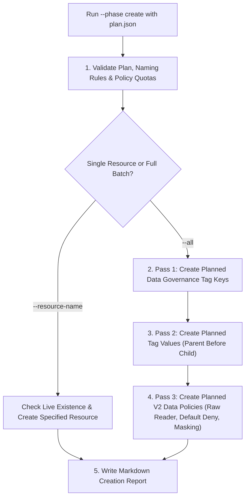

# Phase 2a: Create (`--phase create`)

**Phase Guides:** [Overview (`README.md`)](./README.md) |
[Phase 1a: Analyze](./phase_1a_analyze.md) |
[Phase 1b: Plan](./phase_1b_plan.md) | **Phase 2a: Create** |
[Phase 2b: Delete](./phase_2b_delete.md) |
[Phase 3: Swap & Rollback](./phase_3_swap.md) | [Changelog](./CHANGELOG.md)

## 1. Purpose, Scope & Decision Tree

Phase 2a (`--phase create`) executes the migration plan blueprint (`plan.json`)
generated in [Phase 1b: Plan](./phase_1b_plan.md) to provision target Data
Governance Tag resources in Google Cloud: Cloud Resource Manager Tag Keys
(`purpose = DATA_GOVERNANCE`), hierarchical Tag Values, and BigQuery V2 Data
Policies (`RAW_DATA_ACCESS_POLICY` and `DATA_MASKING_POLICY`).

Phase 2a is **strictly additive**: it creates target governance resources and
configures V2 Data Policy `grantees` without modifying any existing BigQuery
table schemas or altering current Policy Tag Column-Level Security enforcement.

### Recommended Creation Workflow & Execution Modes

Rather than creating all resources in a single live batch right away, follow the
progressive 3-step workflow below:

<!-- mdformat off -->

| Step / Goal | Mode & Required Flags | Behavior |
| :--- | :--- | :--- |
| **Step 1: Preview all planned creations against live GCP state (Recommended First Step)** | `--phase create --plan-file plan.json --all --dry-run --report-file create_dry_run_report.md` | Checks live Tag Keys, Tag Values, and V2 Data Policies; reports what would be created vs. skipped and flags any validation or quota issues without modifying Google Cloud. |
| **Step 2: Create a representative sample set covering each resource type and variant (Recommended Before Full Batch)** | `--phase create --plan-file plan.json --resource-type <type> --resource-name <name> [--dry-run]` | Validates and creates individual sample resources from `plan.json`—such as one `dg-tag-key`, root and nested child `dg-tag-value` items, and one `data-policy-v2` of each variant in your plan (`_default_deny`, Raw Reader, predefined masking, and custom routine masking)—to verify IAM permissions and confirm every variant provisions cleanly before running `--all`. For `data-policy-v2`, always pass `--resource-name` as `<target_project_id>/<data_policy_id>` in both Mode 1 (`--target-default-dp-project-id`) and Mode 2 (`--target-table-dp-project-ids`). |
| **Step 3: Create all remaining planned Tag Keys, Tag Values, and V2 Data Policies in batch** | `--phase create --plan-file plan.json --all --report-file create_report.md` | Creates all remaining Tag Keys, Tag Values (parent-before-child), and V2 Data Policies (Raw Reader, Default Deny, and Migrated V1 policies) in dependency order. Skips already-existing resources (including Step 2 sample resources) idempotently. |
| **Optional: Delete an individual test resource during sandbox cleanup** | See the [Phase 2b: Delete guide](./phase_2b_delete.md) (`--phase delete`) | Deletes a single resource (`data-policy-v2`, `dg-tag-value`, or `dg-tag-key`) in bottom-up order with dependency and Fail-Open safety checks. |

<!-- mdformat on -->

## 2. Prerequisites & Minimum IAM Roles by Project Scope

To run `--phase create`, the caller's Application Default Credentials (ADC) must
hold the following minimum permissions on the target projects configured during
Phase 1b (`--phase plan`):

<!-- mdformat off -->

| Project Scope | Required IAM Permissions | Predefined Role(s) | Why Required |
| :--- | :--- | :--- | :--- |
| **Target DG Tag Project (`--target-dgt-project-id` in `--phase plan`)** | `resourcemanager.tagKeys.list`<br>`resourcemanager.tagKeys.create`<br>`resourcemanager.tagValues.list`<br>`resourcemanager.tagValues.create` | `roles/resourcemanager.tagAdmin` | Lists existing Tag Keys and Tag Values for idempotency checks and creates new `DATA_GOVERNANCE` Tag Keys and hierarchical Tag Values. |
| **Target DG Tag Project (`--target-dgt-project-id` in `--phase plan`)** | `resourcemanager.tagValueBindings.create` (and tag association permission when binding V2 Data Policies to Tag Values) | `roles/resourcemanager.tagUser` | Required by BigQuery Data Policy Service when associating a V2 Data Policy with a Data Governance Tag Value during policy creation. |
| **Target V2 Data Policy Project(s)** (configured in `--phase plan`: either the centralized default Data Policy project from Mode 1 `--target-default-dp-project-id`, or each table's parent project from Mode 2 `--target-table-dp-project-ids`) | `bigquery.dataPolicies.get`<br>`bigquery.dataPolicies.list`<br>`bigquery.dataPolicies.create`<br>`bigquery.dataPolicies.setIamPolicy` | `roles/bigquerydatapolicy.admin` | Checks whether each planned V2 Data Policy already exists and creates V2 Raw Data Access and Data Masking Policies with inline `grantees`. |

<!-- mdformat on -->

**Note:** `--phase create` does **not** query the Source Taxonomy Project or
target BigQuery tables; all source Policy Tag and IAM metadata is read directly
from `--plan-file`.

## 3. Complete CLI Flag Reference

<!-- mdformat off -->

| Flag | Required | Default | Description |
| :--- | :--- | :--- | :--- |
| `--phase` | **Yes** | - | Must be set to `create`. |
| `--plan-file` | **Yes** | - | Path to the JSON migration plan (`plan.json`) generated by `--phase plan`. |
| `--all` | Mutually exclusive with `--resource-name` (one required) | `False` | Creates all planned Tag Keys, Tag Values, and V2 Data Policies in dependency order. |
| `--resource-name` | Mutually exclusive with `--all` (one required) | `None` | Project-qualified identifier of a single resource from `plan.json` to create (see Section 4 for the expected format per `--resource-type`; legacy domain-scoped `example.com:project` IDs are not supported). |
| `--resource-type` | Required when `--resource-name` is set | `None` | Type of the individual resource to create: `dg-tag-key`, `dg-tag-value`, or `data-policy-v2`. |
| `--dry-run` | Optional (Strongly Recommended First) | `False` | Inspects live Google Cloud state and writes a preview report classifying resources into Would Create vs. Would Skip without modifying any cloud resources. |
| `--allow-unresolved-plan-warnings` | Optional | `False` | Overrides the default `BLOCKED_UNRESOLVED_PLAN_WARNINGS` gate when `plan.json` contains unresolved `[ACTION REQUIRED]` warnings (see Section 4). |
| `--skip-confirmation` | Optional | `False` | Bypasses the interactive `Proceed with creation of ALL resources? (y/n):` (or `Proceed? (y/n):` for `--resource-name`) prompt before live creation, and bypasses interactive file-overwrite confirmation prompts when `--overwrite` is also set. |
| `--halt-on-error` | Optional | `False` | When `True`, stops execution immediately on the first creation failure. When `False` (default), logs the failure, skips dependent child resources, and continues creating independent resources. |
| `--report-file` | Optional | `None` (prints to `stdout`) | Path to write the Markdown creation or dry-run report. Written in both `--all` and `--resource-name` modes, even if execution is interrupted or halted. |
| `--log-file` | Optional | `None` | Path to write timestamped runtime execution logs and diagnostic details. |
| `--overwrite` | Optional | `False` | Allows overwriting existing non-empty `--report-file` or `--log-file` (prompts interactively per file unless `--skip-confirmation` is also set). |
| `--debug` | Optional | `False` | Enables `DEBUG`-level logging and full stack traces on failure. |
| `--datapolicy-endpoint`, `--resourcemanager-endpoint` | Optional | `None` | Custom API endpoint hostnames for BigQuery Data Policy Service and Cloud Resource Manager in regional or VPC Service Controls environments. |

<!-- mdformat on -->

### Exit Codes

*   **Exit Code `0`:** All targeted resources were created, skipped because they
    already exist in Google Cloud, or validated as ready to create in
    `--dry-run` mode with zero failures; or you answered `n` at an interactive
    confirmation prompt (`--overwrite` output-file prompt or live creation
    `Proceed ...? (y/n):` prompt, both of which run after startup CLI, output
    file, `plan.json`, and credential validation and before any Google Cloud
    resources are created).
*   **Exit Code `1`:** A pre-prompt startup or `plan.json` check failed
    (`BLOCKED_UNRESOLVED_PLAN_WARNINGS` as described in Section 4, missing or
    malformed `plan.json` or unknown/unqualified `--resource-name`, existing
    output file without `--overwrite`, unwritable output path, or missing
    credentials), an interactive prompt was interrupted (`Ctrl+C` or closed
    `stdin`), or one or more resources failed to create, were skipped because a
    parent Tag Key or Tag Value failed to create, or failed pre-flight
    validation in `--dry-run` mode (whether `--halt-on-error` is `False` or
    `True`; when `--halt-on-error` is `True`, execution halts immediately on the
    first failure instead of continuing independent resources).
*   **Exit Code `2`:** Unrecognized CLI flags, invalid flag choices, or missing
    or conflicting required CLI flags (missing `--plan-file`, omitting both
    `--all` and `--resource-name`, passing both `--all` and `--resource-name`,
    or omitting `--resource-type` / `--resource-name` when the other is set)
    rejected by the CLI argument parser.

## 4. How Phase 2a Works



### High-Level Execution Flow

1.  **Pre-Creation Plan & Quota Validation:** Reads `plan.json` and fails closed
    (`BLOCKED_UNRESOLVED_PLAN_WARNINGS`, exit code `1`) before prompting or
    calling Google Cloud if `plan.json` still contains any unresolved
    `[ACTION REQUIRED]` warnings (unless `--allow-unresolved-plan-warnings` is
    passed, which logs a warning and continues attempting all remaining valid
    resources when `--halt-on-error` is `False`, or stops on the first API
    failure when `--halt-on-error` is `True`). It also surfaces Disaster
    Recovery (Cross-Region Replication) reminders, checks that Tag Key/Value
    names (`1-63` characters), descriptions (`<= 256` characters), and V2 Data
    Policy IDs (`1-200` alphanumeric/underscore characters) satisfy Google Cloud
    constraints, rejects unresolved custom masking routine project placeholders,
    cross-project custom masking routines (where `data_masking_policy.routine`
    resides in a project different from the V2 Data Policy's
    `target_project_id`), BigQuery Authorized Routine grantees (`/routines/`),
    policies exceeding `500` distinct IAM principals or `100` distinct
    `principalSet://` group principals, and planned or combined
    live-plus-planned resources exceeding `1,000` Tag Keys per project (shared
    with existing IAM Tag Keys in `--target-dgt-project-id`), `1,000` Tag Values
    per Tag Key, or `1,000` V2 Data Policies per Tag Key within a target project
    and region. In `--dry-run` mode, these deterministic API and quota
    violations fail pre-flight validation under
    `### Failed Pre-Flight Checks / Blockers` and return exit code `1`. If an
    organizationless project fails tag or policy creation, the tool also logs an
    explicit Google Cloud Organization membership requirement hint.
2.  **Live Check-Before-Create Idempotency:** Before creating any resource, the
    tool checks live Google Cloud state rather than relying on local state
    files. Existing resources are skipped automatically. When skipping a
    pre-existing V2 Data Policy, the tool compares its live configuration
    (`data_policy_type`, `data_governance_tag`, `data_masking_policy`, and
    `grantees`) against `plan.json` and records a configuration drift warning in
    `### Potential Issues & Warnings` if any attribute differs (summarizing
    `grantees` mismatches as bounded missing/extra principal diffs capped at 5
    items per list alongside total counts). If a pre-existing Tag Key with the
    same name does not have `purpose = DATA_GOVERNANCE`, creation fails with a
    clear error showing the live purpose name so governance policies are never
    attached to a standard IAM Tag Key.
3.  **Dependency-Ordered Batch Creation (`--all`):** Provisions resources top
    down across three passes:
    *   **Pass 1 - Data Governance Tag Keys:** Creates planned global Tag Keys
        (`purpose = DATA_GOVERNANCE`) in the target tag project (skipping any
        already created).
    *   **Pass 2 - Data Governance Tag Values:** Creates planned Tag Values from
        parent to child so parent tags always exist before child tags are
        created. If a parent tag fails, its dependent child tags are skipped and
        recorded as failed without issuing unnecessary API calls.
    *   **Pass 3 - Regional V2 Data Policies:** Creates planned Raw Reader
        parity policies, Fail-Closed Default Deny (`_default_deny`) safety-net
        policies, and migrated V1 Data Masking or access policies in each target
        Data Policy project and region.
4.  **Single-Resource Creation (`--resource-name`):** Creates or previews a
    single resource from `plan.json` using its project-qualified identifier for
    the selected `--resource-type` (passing an unqualified `<data_policy_id>`
    raises an immediate validation error before prompting):
    *   **`dg-tag-key`:** `<project_id>/<key_short_name>` (for example,
        `central-dgt-project/customer_pii`).
    *   **`dg-tag-value`:** `<project_id>/<key_short_name>/<value_short_name>`
        for a root Tag Value, or the full slash-delimited hierarchy
        `<project_id>/<key_short_name>/<parent_short_name>/.../<value_short_name>`
        for a nested Tag Value (for example,
        `central-dgt-project/customer_pii/contact/email`; a unique 3-segment
        `<project_id>/<key_short_name>/<value_short_name>` path is also resolved
        automatically).
    *   **`data-policy-v2`:** `<target_project_id>/<data_policy_id>` in both
        Mode 1 (`--target-default-dp-project-id`) and Mode 2
        (`--target-table-dp-project-ids`) (for example,
        `central-dp-project/migrated_raw_customer_pii_email`).

## 5. Report Outputs & Annotated Sample Usage

<!-- mdformat off -->

| Output | Flag | Format | Primary Audience & Purpose | Content |
| :--- | :--- | :--- | :--- | :--- |
| **Creation Report** | `--report-file` (or `stdout`) | Markdown (`.md`) | Migration leads, security auditors, and data stewards reviewing resource creation outcomes and pre-flight warnings. | Summary counts (`Succeeded`/`Would Create`, `Skipped`/`Would Skip (Already Exist)`, `Failed`/`Failed / Blocked`, and `Plan / Quota Blockers` when quota limits are breached), itemized resources by category, failure/pre-flight blocker reasons, `Potential Issues & Warnings`, and (when failures occur) an automatic `### Error & Failure Status Reference` explaining each failure status. |
| **Execution Log** | `--log-file` | Plain text (`.log`) | (1) Your engineering team to troubleshoot and debug script execution, and (2) sharing diagnostic logs with Google Cloud Support or Google engineering so Google can help debug issues. | Timestamped API operations, retry attempts, and detailed error diagnostics and stack traces (when `--debug` is set). |

<!-- mdformat on -->

### Annotated Sample Usage (Recommended 3-Step Progressive Workflow)

```bash
# Step 1: Preview all planned creations in Dry-Run mode (Recommended First Step)
python main.py --phase create \
  --plan-file plan.json \
  --all \
  --dry-run \
  --report-file create_dry_run_report.md \
  --log-file create_dry_run.log

# Step 2: Create a representative sample set covering each resource type and
# variant in plan.json to verify IAM permissions and confirm every variant
# provisions cleanly before running --all.
# 2a. Create one Data Governance Tag Key:
python main.py --phase create \
  --plan-file plan.json \
  --resource-type dg-tag-key \
  --resource-name "target-dgt-proj/pii_taxonomy" \
  --report-file create_test_key_report.md

# 2b. Create sample root and nested child Data Governance Tag Values:
python main.py --phase create \
  --plan-file plan.json \
  --resource-type dg-tag-value \
  --resource-name "target-dgt-proj/pii_taxonomy/Contact" \
  --report-file create_test_root_value_report.md

python main.py --phase create \
  --plan-file plan.json \
  --resource-type dg-tag-value \
  --resource-name "target-dgt-proj/pii_taxonomy/Contact/Email" \
  --report-file create_test_child_value_report.md

# 2c. Create one sample V2 Data Policy for each variant present in plan.json
# (for example, _default_deny, Raw Reader, predefined masking, and custom
# routine masking; always pass <target_project_id>/<data_policy_id> in both
# Mode 1 and Mode 2):
python main.py --phase create \
  --plan-file plan.json \
  --resource-type data-policy-v2 \
  --resource-name "data-proj-a/migrated_raw_pii_taxonomy_email_default_deny" \
  --report-file create_test_default_deny_report.md

python main.py --phase create \
  --plan-file plan.json \
  --resource-type data-policy-v2 \
  --resource-name "data-proj-a/migrated_masking_pii_taxonomy_email_mask" \
  --report-file create_test_masking_report.md

# Step 3: Create all remaining planned resources in batch
# (Sample resources already created in Step 2 are skipped automatically)
python main.py --phase create \
  --plan-file plan.json \
  --all \
  --report-file create_report.md \
  --log-file create.log
```

Sample `create_report.md` structure:

```markdown
# Data Governance Tag Resource Creation Report

## Summary
- **DG Tag Keys:** Succeeded: 1, Skipped: 0, Failed: 0
- **DG Tag Values:** Succeeded: 1, Skipped: 0, Failed: 0
- **Data Policies V2:** Succeeded: 2, Skipped: 0, Failed: 0

## Details

### Succeeded Creations
#### DG Tag Keys
- target-dgt-proj/pii_taxonomy
#### DG Tag Values
- target-dgt-proj/pii_taxonomy/Email
#### Data Policies V2
- data-proj/migrated_raw_pii_taxonomy_email_default_deny
- data-proj/migrated_masking_email_mask_policy
```

In `--dry-run` mode (`--phase create --all --dry-run`), the report header and
section titles indicate preview mode:

```markdown
# Data Governance Tag Resource Creation Report (DRY RUN)

**Dry-Run Mode:** No resources were created or modified in Google Cloud. Review the proposed creations and any potential issues below before re-running without `--dry-run`.

## Summary
- **DG Tag Keys:** Would Create: 1, Would Skip (Already Exist): 0, Failed / Blocked: 0
- **DG Tag Values:** Would Create: 1, Would Skip (Already Exist): 0, Failed / Blocked: 0
- **Data Policies V2:** Would Create: 2, Would Skip (Already Exist): 0, Failed / Blocked: 0
```

## 6. Scalability, Operational Guardrails & Customer Pitfalls

### Scalability & Resumability

*   **Efficient Tag Lookups & Automatic Retries:** Lists existing Tag Keys once
    per project and direct child Tag Values once per parent tag, caching
    resolved IDs in memory so large hierarchies with hundreds of sibling Tag
    Values avoid redundant API calls. Transient rate-limit (`429`) and server
    (`5xx`) errors are retried automatically with exponential backoff.
*   **Expected Runtime & Safe Re-Runs:** Because Google Cloud processes each new
    Tag Key and Tag Value creation synchronously, provisioning taxonomies with
    hundreds of Tag Values can take several minutes. If a run is interrupted,
    re-running `--phase create --all` safely skips all previously created Tag
    Keys, Tag Values, and V2 Data Policies.

### Operational Guardrails & Customer Pitfalls

1.  **Mandatory 5-7 Minute IAM & Tag Propagation Soak Window Before Phase 3:**
    *   **Why:** Cloud Resource Manager Tag bindings and BigQuery V2 Data Policy
        IAM bindings (`grantees`) are eventually consistent across global caches
        (typically 1-7 minutes).
    *   **Action:** Wait **at least 5-7 minutes** after `--phase create`
        completes before running `--phase swap` (see the
        [Phase 3: Swap & Rollback guide](./phase_3_swap.md)) so BigQuery queries
        do not encounter transient `403 Access Denied` errors immediately after
        table cutover.
2.  **Why Every Access-Controlled Policy Tag Also Creates a `_default_deny`
    `RAW_DATA_ACCESS_POLICY` Safety Net:**
    *   **Why:** Legacy Policy Tags are **Fail-Closed** (enforcing Default Deny
        as soon as `FINE_GRAINED_ACCESS_CONTROL` is enabled on the taxonomy or a
        V1 Data Policy is attached), whereas Data Governance Tags are
        **Fail-Open** unless governed by a `RAW_DATA_ACCESS_POLICY`. Attaching
        only a `DATA_MASKING_POLICY` to a Data Governance Tag Value without a
        companion `RAW_DATA_ACCESS_POLICY` would allow non-masked table readers
        to read unmasked data.
    *   **Action:** Keep all entries under
        `policy_tags_to_default_deny_data_policies_v2` intact in `plan.json` and
        keep `_default_deny` policies attached on active Tag Values.
3.  **Cross-Field Invariants When Editing `plan.json` Before `--phase create`:**
    *   **Why:** If you customize `short_name`, `namespaced_name`, or
        `policy_id` in `plan.json`, references across
        `phase_2_resource_manifest` and `phase_3_binding_map` must stay
        synchronized.
    *   **Action:** If you rename a Tag Key or Tag Value in
        `taxonomies_to_dg_tag_keys` or `policy_tags_to_dg_tag_values`, update
        the matching `parent_namespaced_name`, `dg_tag_value_namespaced_name`,
        `api_payload.data_governance_tag.key`/`value`, and
        `phase_3_binding_map.policy_tags_to_dg_tag_values` entries, then run
        `--phase create --all --dry-run` to verify referential integrity before
        live creation.
4.  **Tag, Policy & Grantee Quota Limits (`1,000` Tag Keys/Project, `1,000` Tag
    Values/Key, `1,000` Policies/Key & `500` Principals/`100` Groups per Policy)
    and Organization Requirement:**
    *   **Why:** Google Cloud requires participating projects to belong to a
        Google Cloud Organization resource (organizationless projects cannot
        provision `DATA_GOVERNANCE` Tag Keys or V2 Data Policies) and enforces
        default limits of `1,000` total Tag Keys per project (shared across
        standard IAM Tag Keys and `DATA_GOVERNANCE` Tag Keys in
        `--target-dgt-project-id`), `1,000` Tag Values per Tag Key, `1,000` V2
        Data Policies per `(project, region, DG Tag Key)` tuple (including CRR
        replicated policies in secondary regions), and `500` distinct IAM
        principals / `100` distinct `principalSet://` group principals per V2
        Data Policy.
    *   **Action:** Review the `Failed Pre-Flight Checks / Blockers` (including
        `Plan & Quota Limits`) and `Potential Issues & Warnings` sections in
        `create_dry_run_report.md` (and your Phase 1b plan summary report). If
        any limit is exceeded, consolidate child reader grants onto parent tags,
        consolidate individual user grants into Google Groups (or narrow groups
        into parent groups), prune unused tags, or split large taxonomies across
        smaller domain Tag Keys or dedicated tag projects before running
        `--phase create`.
5.  **Same-Project Requirement for Custom Masking Routines
    (`data_masking_policy.routine`):**
    *   **Why:** BigQuery Data Policy Service allows a V2 Data Policy to
        reference a global Data Governance Tag in another project, but requires
        any custom masking routine
        (`projects/<routine_project>/datasets/<dataset>/routines/<routine>`) to
        reside in the **same project** as the V2 Data Policy
        (`All referenced resources must reside in the same project.`).
    *   **Action:** If `plan.json` contains an `[ACTION REQUIRED]` warning (or a
        dry-run pre-flight error) for a cross-project custom masking routine on
        `<target_project_id>/<policy_id>`, either create an equivalent
        `DATA_MASKING` routine in `<target_project_id>` (in the same region),
        update `api_payload.data_masking_policy.routine` in `plan.json` to
        reference `<target_project_id>`, and remove the warning, or remove that
        `<target_project_id>` policy entry from
        `data_policies_v1_to_data_policies_v2` if no tables in
        `<target_project_id>` use that tag.
