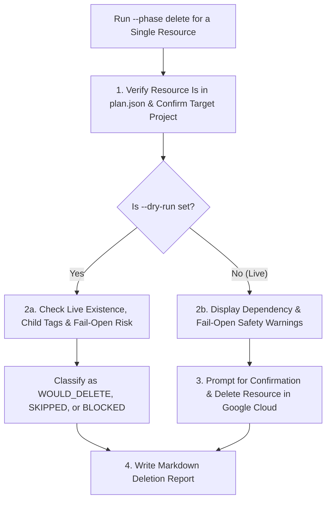

# Phase 2b: Delete (`--phase delete`)

**Phase Guides:** [Overview (`README.md`)](./README.md) |
[Phase 1a: Analyze](./phase_1a_analyze.md) |
[Phase 1b: Plan](./phase_1b_plan.md) | [Phase 2a: Create](./phase_2a_create.md)
| **Phase 2b: Delete** | [Phase 3: Swap & Rollback](./phase_3_swap.md) |
[Changelog](./CHANGELOG.md)

## 1. Purpose, Scope & Decision Tree

Phase 2b (`--phase delete`) deletes an individual target Data Governance
resource (`data-policy-v2`, `dg-tag-value`, or `dg-tag-key`) that is defined in
the migration plan (`plan.json`). It is designed for non-production sandbox
testing, surgical cleanup of a misconfigured resource, or step-by-step teardown
before re-running [Phase 2a: Create](./phase_2a_create.md).

**No Bulk `--all` Flag by Design:** `--phase delete` requires explicit
per-resource invocation (`--resource-type` and `--resource-name`) and does not
provide a `"Delete All"` flag for two reasons:

*   **Protecting Pre-Existing Resources & Preventing Fail-Open Exposure:** It
    prevents accidental mass deletion of pre-existing customer resources (Tag
    Keys, Tag Values, or V2 Data Policies created outside the migration tool)
    whose names happen to match entity names in `plan.json` - especially because
    deleting a `_default_deny` `RAW_DATA_ACCESS_POLICY` on a Tag Value that is
    bound to a BigQuery column immediately flips that column from Fail-Closed
    (Default Deny) to **Fail-Open (Default Allow)**.
*   **Avoiding Unnecessary Bulk-Deletion Risk:** Mass deletion of Data
    Governance Tag resources is not a required phase of a production Policy Tag
    to Data Governance Tag migration, keeping cleanup deliberate and scoped to a
    single resource at a time.

**Recommended Best Practice (Always Run Dry-Run First):** Always run
`--phase delete --dry-run` before live deletion. Both `--dry-run` and live
deletion inspect child Tag Value and V2 Data Policy dependencies and emit an
explicit `[WARNING - FAIL-OPEN RISK]` alert before prompting if you target a
`_default_deny` safety-net policy or another V2 Data Policy protecting a Tag
Value.

### Deletion Order & Decision Tree

Google Cloud enforces strict referential integrity on Data Governance Tags. You
must delete resources **bottom-up** (reverse dependency order):

1.  **Step 1 - Unbind Tag Values from BigQuery Table Columns:** If any BigQuery
    table column in *any* project has the DG Tag Value attached, roll back the
    table schema first via `--phase swap --swap-mode dgt-to-pt` (see the
    [Phase 3: Swap & Rollback guide](./phase_3_swap.md)); live Tag Value
    deletion is blocked if any column or V2 Data Policy attachment remains (see
    Section 4).
2.  **Step 2 - Delete Referencing V2 Data Policies
    (`--resource-type data-policy-v2 --allow-fail-open-policy-delete`):** After
    verifying zero BigQuery columns still reference the Tag Value, delete all V2
    Data Policies referencing the Tag Value across every project (passing
    `<target_project_id>/<data_policy_id>` and explicit
    `--allow-fail-open-policy-delete` for each policy in `plan.json`, and
    removing any out-of-plan V2 Data Policies created in other projects).
    Because BigQuery skips active table column-reference checks when deleting
    tag-based V2 Data Policies, live `data-policy-v2` deletion is blocked by
    default (`BLOCKED`) unless `--allow-fail-open-policy-delete` is passed
    (never implied by `--skip-confirmation`).
3.  **Step 3 - Delete DG Tag Values Bottom-Up
    (`--resource-type dg-tag-value`):** Delete leaf Tag Values first, then
    parent Tag Values up to the root Tag Value.
4.  **Step 4 - Delete the DG Tag Key Last (`--resource-type dg-tag-key`):** Once
    all child Tag Values under the Tag Key are deleted, delete the Tag Key.

## 2. Prerequisites & Minimum IAM Roles by Project Scope

<!-- mdformat off -->

| Project Scope | Required IAM Permissions | Predefined Role(s) | Why Required |
| :--- | :--- | :--- | :--- |
| **Target DG Tag Project (`--target-dgt-project-id` in `--phase plan`)** | `resourcemanager.tagKeys.list`<br>`resourcemanager.tagKeys.delete`<br>`resourcemanager.tagValues.list`<br>`resourcemanager.tagValues.delete` | `roles/resourcemanager.tagAdmin` | Resolves Tag Key and Tag Value IDs, checks live child Tag Value dependencies, and deletes Tag Values and Tag Keys. |
| **Target V2 Data Policy Project(s)** (configured in `--phase plan`: either the centralized default Data Policy project from Mode 1 `--target-default-dp-project-id`, or each table's parent project from Mode 2 `--target-table-dp-project-ids`) | `bigquery.dataPolicies.get`<br>`bigquery.dataPolicies.list`<br>`bigquery.dataPolicies.delete` | `roles/bigquerydatapolicy.admin` | Checks whether the V2 Data Policy exists and deletes the V2 Data Policy. |

<!-- mdformat on -->

## 3. Complete CLI Flag Reference

<!-- mdformat off -->

| Flag | Required | Default | Description |
| :--- | :--- | :--- | :--- |
| `--phase` | **Yes** | - | Must be set to `delete`. |
| `--plan-file` | **Yes** | - | Path to the JSON migration plan (`plan.json`). Used as an allowlist: the tool refuses to delete any resource that is not defined in `plan.json`. |
| `--resource-type` | **Yes** | - | Type of resource to delete: `data-policy-v2`, `dg-tag-value`, or `dg-tag-key`. |
| `--resource-name` | **Yes** | - | Identifier of the resource in `plan.json` (legacy domain-scoped `example.com:project` IDs are not supported):<br>- For `dg-tag-key`: `<project_id>/<key_short_name>`<br>- For `dg-tag-value`: `<project_id>/<key_short_name>/<value_short_name>` (or full hierarchical path)<br>- For `data-policy-v2`: `<target_project_id>/<data_policy_id>` (required in both Mode 1 `--target-default-dp-project-id` and Mode 2 `--target-table-dp-project-ids`). |
| `--dry-run` | Optional (Strongly Recommended First) | `False` | Client-side preview that checks live existence, live child Tag Values (`tagValues.list`), planned referencing V2 Data Policies in `plan.json`, and Fail-Open risks without deleting any resource (see Section 4 for dry-run vs. live server-side scope). |
| `--allow-fail-open-policy-delete` | Required for live `data-policy-v2` deletion | `False` | Explicitly authorizes live deletion of a `data-policy-v2` resource after you confirm its Tag Value is no longer bound to any BigQuery columns. Because BigQuery does not check active column bindings when deleting tag-based V2 Data Policies, live `data-policy-v2` deletion is blocked (`BLOCKED`, exit code `1`) unless this flag is set (`--skip-confirmation` never implies this override). |
| `--skip-confirmation` | Optional | `False` | Bypasses the interactive `Proceed? (y/n):` prompt before live deletion, and bypasses interactive file-overwrite confirmation prompts when `--overwrite` is also set (does not override `--allow-fail-open-policy-delete`). |
| `--halt-on-error` | Optional | `False` | Accepted for CLI consistency across phases; because `--phase delete` targets a single resource per run, any live deletion or validation error stops immediately and exits with status code `1`. |
| `--report-file` | Optional | `None` (prints to `stdout`) | Path to save the Markdown deletion (or dry-run) report. Written even when a live deletion API call fails. |
| `--log-file` | Optional | `None` | Path to save timestamped execution logs and diagnostic details. |
| `--overwrite` | Optional | `False` | Allows overwriting existing non-empty `--report-file` or `--log-file` (prompts interactively per file unless `--skip-confirmation` is also set). |
| `--debug` | Optional | `False` | Enables `DEBUG`-level logging and full stack traces on failure. |
| `--datapolicy-endpoint`, `--resourcemanager-endpoint` | Optional | `None` | Custom API endpoint hostnames for BigQuery Data Policy Service and Cloud Resource Manager in regional or VPC Service Controls environments. |

<!-- mdformat on -->

### Exit Codes

*   **Exit Code `0`:** The targeted resource was deleted (`DELETED`), skipped
    because it is already absent in Google Cloud (`SKIPPED`), or verified as
    ready to delete in `--dry-run` mode (`WOULD_DELETE`); or you answered `n` at
    an interactive confirmation prompt (`--overwrite` output-file prompt or live
    deletion `Proceed? (y/n):` prompt).
*   **Exit Code `1`:** Dry-run dependency inspection reported `BLOCKED` (for
    example, live child Tag Values or planned referencing V2 Data Policies still
    exist), live `data-policy-v2` deletion reported `BLOCKED` because
    `--allow-fail-open-policy-delete` was omitted, live deletion returned
    `FAILED` (for example, `400 FAILED_PRECONDITION` when attachments remain;
    see Section 4), an interactive prompt was interrupted (`Ctrl+C` or closed
    `stdin`), the resource is not in `plan.json` or `--resource-name` omitted
    `<target_project_id>/` for `data-policy-v2`, or a startup, file, or
    credential error occurred (whether `--halt-on-error` is `False` or `True`,
    because `--phase delete` targets a single resource per run).
*   **Exit Code `2`:** Unrecognized CLI flags, invalid `--resource-type` choice,
    passing `--all` (which is forbidden in `--phase delete`), or omitting
    required `--plan-file`, `--resource-name`, or `--resource-type` flags
    rejected by the CLI argument parser.

## 4. How Phase 2b Works



### High-Level Execution Flow

1.  **Migration Plan Allowlist & Project-Qualified Policy Naming:**
    *   **Protecting Unrelated Resources:** Before contacting Google Cloud, the
        tool verifies that the requested `--resource-type` and `--resource-name`
        are part of `plan.json`. If the resource is not in the migration plan,
        the tool stops immediately without modifying Google Cloud so
        pre-existing resources created outside the migration are protected.
    *   **Explicit `<target_project_id>/<data_policy_id>` Format for V2 Data
        Policies:** For `--resource-type data-policy-v2`, `--resource-name` must
        always be passed as `<target_project_id>/<data_policy_id>` in both Mode
        1 (`--target-default-dp-project-id`) and Mode 2
        (`--target-table-dp-project-ids`). Passing a bare `<data_policy_id>`
        raises an immediate validation error before prompting so you always
        confirm the exact target project being modified. For
        `--resource-type dg-tag-value`, you can pass either the full
        slash-delimited hierarchy
        `<project_id>/<key_short_name>/<parent_short_name>/.../<value_short_name>`
        from `plan.json` or a unique 3-segment
        `<project_id>/<key_short_name>/<value_short_name>` path.
2.  **Dependency & Fail-Open Safety Checks (Client-Side Dry-Run vs. Server-Side
    Live Enforcement):**
    *   **Client-Side `--dry-run` Inspection:** Inspects Google Cloud without
        deleting anything and reports **`WOULD_DELETE`** (exists and has no live
        child Tag Values or live referencing V2 Data Policies from `plan.json`
        blocking deletion), **`SKIPPED`** (already absent in Google Cloud), or
        **`BLOCKED`** (when a Tag Key or Tag Value still has live child Tag
        Values via `tagValues.list` or live referencing V2 Data Policies in
        `plan.json`). Because `plan.json` only lists target Data Policy projects
        from Phase 1b, client-side `--dry-run` cannot discover BigQuery table
        column bindings or out-of-plan V2 Data Policies created in other
        projects.
    *   **Global Server-Side Enforcement During Live Deletion:** When
        `tagValues.delete` runs in live mode, Google Cloud Resource Manager
        enforces global tag attachment integrity across all projects and rejects
        deletion with `400 FAILED_PRECONDITION` (reported as **`FAILED`**) if
        *any* BigQuery column or V2 Data Policy in *any* project still
        references the Tag Value—even if `--dry-run` reported `WOULD_DELETE`.
    *   **Fail-Closed Live V2 Data Policy Deletion Gate
        (`--allow-fail-open-policy-delete`) & Dependency Warnings:** Unlike
        Cloud Resource Manager `tagValues.delete` (which rejects deletion when
        table columns still reference a Tag Value), BigQuery does **not** check
        active table column references when deleting tag-based V2 Data Policies.
        Deleting a `_default_deny` safety-net policy or raw-access policy while
        its Tag Value is still bound to BigQuery columns immediately causes
        those columns to revert to Default Allow (Fail-Open). Therefore:
        *   In `--dry-run` mode, the tool emits a `[WARNING - FAIL-OPEN RISK]`
            alert in the preview report.
        *   In live mode, if the V2 Data Policy is already absent in Google
            Cloud (`404`), the tool returns `SKIPPED`; otherwise, it **blocks
            deletion upfront (`BLOCKED`, exit code `1`) before prompting**
            unless `--allow-fail-open-policy-delete` is explicitly passed
            (`--skip-confirmation` never implies this override).
        *   When targeting a Tag Value, the tool warns if `plan.json` defines
            child Tag Values or referencing V2 Data Policies.
3.  **Interactive Confirmation & Bottom-Up Deletion:**
    *   If the resource does not exist in Google Cloud, the tool records
        `SKIPPED` and exits cleanly.
    *   Otherwise, in live mode, the tool displays any pre-delete warnings,
        prompts `Proceed? (y/n):` (unless `--skip-confirmation` is set), waits
        for the Google Cloud deletion operation to finish, and writes the
        Markdown report (including a `FAILED` report if Google Cloud rejects an
        out-of-order deletion). Always follow the bottom-up sequence: unbind
        table columns -> delete **V2 Data Policies** -> delete **leaf Tag
        Values** -> delete **root Tag Values** -> delete **Tag Keys**.

## 5. Report Outputs & Annotated Sample Usage

<!-- mdformat off -->

| Output | Flag | Format | Primary Audience & Purpose | Content |
| :--- | :--- | :--- | :--- | :--- |
| **Deletion Report** | `--report-file` (or `stdout`) | Markdown (`.md`) | Operators, migration leads, and security reviewers verifying deletion previews, outcomes, and Fail-Open warnings. | Target resource type and identifier, outcome status (`DELETED`, `SKIPPED`, `WOULD_DELETE`, `BLOCKED`, or `FAILED`), details, `Potential Issues & Warnings`, and (when `BLOCKED` or `FAILED`) an automatic `## Error & Block Status Reference` explaining the status code. |
| **Execution Log** | `--log-file` | Plain text (`.log`) | (1) Your engineering team to troubleshoot and debug script execution, and (2) sharing diagnostic logs with Google Cloud Support or Google engineering so Google can help debug issues. | Timestamped API operations, retry attempts, and detailed error diagnostics and stack traces (when `--debug` is set). |

<!-- mdformat on -->

### Sample Individual Deletion Commands

```bash
# Step 1: Preview deleting a V2 Data Policy in Dry-Run mode (Strongly Recommended)
# (Always pass <target_project_id>/<data_policy_id> in both Mode 1 and Mode 2)
python main.py --phase delete \
  --plan-file plan.json \
  --resource-type data-policy-v2 \
  --resource-name "data-proj/migrated_raw_pii_taxonomy_email_default_deny" \
  --dry-run \
  --report-file delete_dry_run_report.md

# Step 2: Delete the V2 Data Policy after confirming no BigQuery columns use it
# (Requires --allow-fail-open-policy-delete in live mode)
python main.py --phase delete \
  --plan-file plan.json \
  --resource-type data-policy-v2 \
  --resource-name "data-proj/migrated_raw_pii_taxonomy_email_default_deny" \
  --allow-fail-open-policy-delete \
  --report-file delete_policy_report.md

# Step 3: Delete the leaf DG Tag Value
python main.py --phase delete \
  --plan-file plan.json \
  --resource-type dg-tag-value \
  --resource-name "target-dgt-proj/pii_taxonomy/Email" \
  --report-file delete_value_report.md

# Step 4: Delete the DG Tag Key once all child Tag Values are removed
python main.py --phase delete \
  --plan-file plan.json \
  --resource-type dg-tag-key \
  --resource-name "target-dgt-proj/pii_taxonomy" \
  --report-file delete_key_report.md
```

### Generating an Ordered Bottom-Up Teardown Script From `plan.json`

Because `--phase delete` intentionally rejects `--all` to prevent accidental
bulk deletion of production governance tags, you can generate an inspectable,
bottom-up teardown script (V2 Data Policies first, then leaf-to-root Tag Values
sorted by hierarchy depth descending, and Tag Keys last) for a specific Tag Key
(or the full `plan.json`) and review it before running:

```bash
python3 - << 'EOF' > bottom_up_delete.sh
import json
import shlex

plan_file = "plan.json"
# Optional: set to a specific Tag Key prefix (e.g. "target-dgt-proj/pii_taxonomy")
# or leave empty ("") to include all planned resources in plan.json.
target_tag_key_filter = ""

with open(plan_file, encoding="utf-8") as handle:
  plan = json.load(handle)
manifest = plan.get("phase_2_resource_manifest", {})

def _matches_filter(namespaced_path: str) -> bool:
  if not target_tag_key_filter:
    return True
  return (
      namespaced_path == target_tag_key_filter
      or namespaced_path.startswith(f"{target_tag_key_filter}/")
  )

commands = ["set -e"]

# 1. V2 Data Policies first (<target_project_id>/<policy_id>)
for section_key in (
    "policy_tags_to_raw_reader_data_policies_v2",
    "policy_tags_to_default_deny_data_policies_v2",
    "data_policies_v1_to_data_policies_v2",
):
  for policy_entry in manifest.get(section_key, []):
    val_name = policy_entry.get("dg_tag_value_namespaced_name", "")
    if not _matches_filter(val_name):
      continue
    res_name = f"{policy_entry['target_project_id']}/{policy_entry['policy_id']}"
    commands.append(
        f"python3 main.py --phase delete --plan-file {shlex.quote(plan_file)}"
        f" --resource-name {shlex.quote(res_name)}"
        " --resource-type data-policy-v2 --allow-fail-open-policy-delete"
        " --skip-confirmation"
    )

# 2. DG Tag Values sorted deepest path first (leaf -> intermediate -> root)
sorted_values = sorted(
    [
        entry
        for entry in manifest.get("policy_tags_to_dg_tag_values", [])
        if _matches_filter(entry.get("namespaced_name", ""))
    ],
    key=lambda entry: entry["namespaced_name"].count("/"),
    reverse=True,
)
for value_entry in sorted_values:
  commands.append(
      f"python3 main.py --phase delete --plan-file {shlex.quote(plan_file)}"
      f" --resource-name {shlex.quote(value_entry['namespaced_name'])}"
      " --resource-type dg-tag-value --skip-confirmation"
  )

# 3. DG Tag Keys last
for key_entry in manifest.get("taxonomies_to_dg_tag_keys", []):
  key_name = key_entry.get("namespaced_name", "")
  if not _matches_filter(key_name):
    continue
  commands.append(
      f"python3 main.py --phase delete --plan-file {shlex.quote(plan_file)}"
      f" --resource-name {shlex.quote(key_name)}"
      " --resource-type dg-tag-key --skip-confirmation"
  )

print("\n".join(commands))
EOF

# Inspect the generated bottom-up deletion sequence before executing:
cat bottom_up_delete.sh
```

### Sample Dry-Run Deletion Report (`delete_dry_run_report.md`)

```markdown
# Resource Deletion Report (DRY RUN)

**DRY RUN MODE**: No resources were deleted in Google Cloud. This report previews the deletion outcome and any potential dependency or security issues.

## Summary
- **Resource Type**: `data-policy-v2`
- **Resource Identifier**: `data-proj/migrated_raw_pii_taxonomy_email_default_deny`
- **Status**: **WOULD_DELETE**
- **Details**: Would delete Data Policy V2 `projects/data-proj/locations/us/dataPolicies/migrated_raw_pii_taxonomy_email_default_deny`.
- **Potential Issues Detected**: 1

## Potential Issues & Warnings
- **WARNING**: [WARNING - FAIL-OPEN RISK] Data Policy `projects/data-proj/locations/us/dataPolicies/migrated_raw_pii_taxonomy_email_default_deny` is a Default-Deny safety-net policy for `target-dgt-proj/pii_taxonomy/Email`. If `target-dgt-proj/pii_taxonomy/Email` is currently bound to any BigQuery table columns, deleting its Default-Deny Data Policy without another active policy on that Tag Value will cause those columns to revert to Default Allow (Fail-Open).
```

## 6. Scalability, Operational Guardrails & Customer Pitfalls

### Scalability & Propagation Behavior

*   **Synchronous Completion & Propagation Delay:** Each `--phase delete` run
    waits for Google Cloud's deletion operation to finish before exiting and
    automatically retries transient rate-limit (`429`) or server (`5xx`) errors.
    Note that Google Cloud can take a few minutes to clear backend caches after
    deleting a Tag Key, Tag Value, or V2 Data Policy, so recreating a resource
    with the exact same name immediately after deletion may temporarily fail.

### Operational Guardrails & Customer Pitfalls

1.  **Never Delete `_default_deny` Policies on Active Governed Columns:**
    *   **Why:** Deleting a `_default_deny` `RAW_DATA_ACCESS_POLICY` while its
        DG Tag Value is attached to any BigQuery table column immediately
        exposes that column's unmasked data to all users with table-level
        `bigquery.tables.getData` access (or to all non-masked readers if a
        `DATA_MASKING_POLICY` is also present).
    *   **Action:** Always roll back table schemas via
        `--phase swap --swap-mode dgt-to-pt` before deleting any V2 Data
        Policies.
2.  **Resolving `400 FAILED_PRECONDITION` When Deleting a Tag Value or Tag
    Key:**
    *   **Why:** One or more BigQuery columns (including recently dropped tables
        still retained within BigQuery's Time Travel window), V2 Data Policies
        (including policies outside `plan.json`), or child Tag Values still
        reference the tag in Google Cloud (see Section 4).
    *   **Action:** Run `--phase delete --dry-run` first to identify live child
        Tag Values and planned V2 Data Policies, then use
        `--phase analyze --analyze-type column-binding --verbose-bindings` (or
        roll back remaining tables via `--phase swap --swap-mode dgt-to-pt`)
        plus `--phase analyze --analyze-type static-dgt` across any other data
        projects to clear all remaining bindings before deleting the Tag Value.
        If a table with DGT column bindings was recently dropped (`DROP TABLE`),
        BigQuery retains its soft-deleted schema and tag attachment in the Time
        Travel catalog until the table is recreated and deleted without DGT
        column bindings (or until the Time Travel window expires).
