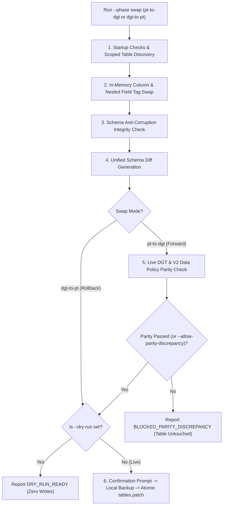

# Phase 3: Swap & Rollback (`--phase swap`)

**Phase Guides:** [Overview (`README.md`)](./README.md) |
[Phase 1a: Analyze](./phase_1a_analyze.md) |
[Phase 1b: Plan](./phase_1b_plan.md) | [Phase 2a: Create](./phase_2a_create.md)
| [Phase 2b: Delete](./phase_2b_delete.md) | **Phase 3: Swap & Rollback** |
[Changelog](./CHANGELOG.md)

## 1. Purpose, Scope & Decision Tree

Phase 3 (`--phase swap`) atomically swaps legacy Policy Tags (PT) and Data
Governance Tags (DGT) on BigQuery table columns using the `phase_3_binding_map`
section in `plan.json` (generated in [Phase 1b: Plan](./phase_1b_plan.md) after
creating target resources in [Phase 2a: Create](./phase_2a_create.md)). Both
top-level columns and nested fields inside `RECORD` / `STRUCT` columns at any
nesting depth are supported.

**Crucial Pre-Production Safety Practice (Rehearse Forward Cutover and Rollback
in a Test Environment First):** Before running `--phase swap` in production,
always exercise the full round-trip sequence on a non-production test or canary
table / dataset first: `pt-to-dgt` (initial forward cutover) -> `dgt-to-pt`
(surgical rollback to Policy Tags) -> `pt-to-dgt` (forward cutover again).
Confirming that `dgt-to-pt` rollback works end-to-end in a test environment
ensures you never run rollback for the first time during a live production
incident.

**Recommended Best Practice (Always Run Dry-Run First):** Updating production
BigQuery table schemas is a high-risk operation. Before executing a live schema
swap or rollback, always run `--phase swap --dry-run`. In dry-run mode, zero
BigQuery table mutations and zero local backup writes occur; the tool transforms
mapped column tags in memory, runs recursive schema anti-corruption checks to
verify no unrelated column properties changed, generates a unified schema diff,
and (in `pt-to-dgt` mode) verifies live Google Cloud Data Governance Tag and V2
Data Policy enforcement parity against `plan.json`, reporting `DRY_RUN_READY`
vs. `BLOCKED_PARITY_DISCREPANCY`.

### Two Symmetric Swap Modes (`--swap-mode`) & Rollback Options

<!-- mdformat off -->

| Mode / Option | Command / Mechanism | What It Does | When to Use |
| :--- | :--- | :--- | :--- |
| **Forward Cutover (`--swap-mode pt-to-dgt`, Default)** | `python main.py --phase swap --plan-file plan.json ...` | Verifies live target DGT and V2 Data Policy parity against `plan.json`, saves a restore-ready schema snapshot to `<backup_dir>/pt_to_dgt/<project>/<dataset>/<table>.json` (with `"dataGovernanceTagsInfo": {"dataGovernanceTags": {}}` on swapped leaf columns so `bq update` clears attached DGTs cleanly), and for each mapped column atomically **(1) clears the existing Policy Tag** by setting `"policyTags": {"names": []}` in the table schema, **(2) adds/attaches the mapped Data Governance Tag** by setting `"dataGovernanceTagsInfo": {"dataGovernanceTags": {"<dg_tag_key>": "<dg_tag_value>"}}` in the table schema via BigQuery `tables.patch`, and **(3) verifies the patched schema** (automatically restoring original tags if BigQuery silently dropped target tags). | Migrating governed BigQuery tables from Policy Tags to Data Governance Tags (at least 5–7 minutes after `--phase create` completes). |
| **Option A Rollback: Automated Surgical Rollback (`--swap-mode dgt-to-pt`, Recommended)** | `python main.py --phase swap --swap-mode dgt-to-pt --plan-file plan.json ...` | Fetches each table's **current live schema**, verifies schema anti-corruption integrity, saves a restore-ready snapshot to `<backup_dir>/dgt_to_pt/<project>/<dataset>/<table>.json` (with `"policyTags": {"names": []}` on swapped leaf columns, preserving the original forward backup), and for each mapped column atomically **(1) clears the mapped Data Governance Tag** by setting `"dataGovernanceTagsInfo": {"dataGovernanceTags": {}}` in the table schema and **(2) adds/restores the original Policy Tag** by setting `"policyTags": {"names": ["<source_policy_tag>"]}` in the table schema via BigQuery `tables.patch` while skipping forward DGT parity checks. | **Primary rollback method**—especially across multiple tables/datasets/projects or hours/days after cutover when downstream pipelines may have added new columns or evolved descriptions/types. |
| **Option B Rollback: Point-in-Time Snapshot Restore (`bq update`)** | `bq update <project>:<dataset>.<table> schema_backups/pt_to_dgt/<project>/<dataset>/<table>.json` | Directly applies the restore-ready pre-swap schema JSON snapshot saved before `pt-to-dgt` executed, atomically clearing `"dataGovernanceTagsInfo"` (`{"dataGovernanceTags": {}}`) and restoring `"policyTags"` on swapped leaf columns in one `bq` CLI call. | **Immediate single-table emergency fallback** during the cutover window if Python or `plan.json` is unavailable AND the table schema has not evolved since cutover. |

<!-- mdformat on -->

**Important (Lockstep Pipeline & IaC Revert on Rollback):** If a table's schema
or column descriptions are managed declaratively by Dataform (`.sqlx` /
JavaScript), dbt (`schema.yml` / `post-hook`), SQLMesh (`post_statements`),
Terraform (`google_bigquery_table`), Google Cloud Config Connector
(`BigQueryTable`), or a scheduled DDL pipeline and you updated those definitions
during forward cutover, you **must** revert them back to Policy Tags in the same
maintenance window as `--swap-mode dgt-to-pt` (before the next scheduled
pipeline run or reconciliation loop). Otherwise, Dataform's or dbt's post-job
`tables.patch` sends an empty `"policyTags": {"names": []}` list for columns
retained in `columns` and strips the restored Policy Tags, and Terraform /
Config Connector will re-apply `"dataGovernanceTagsInfo"` (see Safeguard #6 in
Section 6 below).

## 2. Prerequisites & Minimum IAM Roles by Project Scope

### How Phase 3 Uses Permissions (What Is Checked vs. Not Checked)

Phase 1b (`--phase plan`) already inspected your source Policy Tag IAM bindings
and V1 Data Policies once and recorded the reviewed security mapping in
`plan.json`. Phase 3 validates live target resources against `plan.json` rather
than re-querying source IAM policies during table cutover. This separation lets
dataset and table operators execute `--phase swap` with least-privilege
permissions—without needing broad IAM-policy (`getIamPolicy`) or custom-role
inspection access across centralized source Policy Tag projects—and avoids
source IAM quota bottlenecks during large multi-table cutovers:

*   **What `--phase swap` checks:** In forward cutover
    (`--swap-mode pt-to-dgt`), the tool queries **live Target Data Governance
    Tags** (`resourcemanager.tagKeys.list`, `resourcemanager.tagValues.list`)
    and **live Target V2 Data Policies** (`bigquery.dataPolicies.list`,
    `bigquery.dataPolicies.get`) and compares their existence, policy types,
    masking rules, and grantees against `plan.json` before modifying any table.
    If any mismatch is detected and `--allow-parity-discrepancy` is not set,
    `--phase swap` marks the table `BLOCKED_PARITY_DISCREPANCY`, leaves the
    BigQuery table untouched, records the discrepancy in `--report-file` and
    `--log-file`, and exits with status code `1`.
*   **What `--phase swap` does NOT query:** The tool does **not** call
    `getIamPolicy` on source Policy Tags, source Taxonomies, or source V1 Data
    Policies, and it does **not** query custom IAM role definitions
    (`iam.roles.get`). Freeze changes to source Policy Tag IAM and V1 Data
    Policies between `--phase plan` and `--phase swap` (or re-run Phase 1b
    (`--phase plan`) to regenerate `plan.json` and Phase 2a (`--phase create`)
    to update target DGT and V2 Data Policy resources if source access rules
    change).
*   **Why Source Taxonomy read permissions are still needed during
    `tables.patch`:** Although the migration tool itself does not re-query
    source IAM policies, BigQuery's `tables.patch` API still checks
    `datacatalog.taxonomies.get` / `datacatalog.policyTags.get` on the Source
    Taxonomy Project and `bigquery.tables.setCategory` on the target table
    whenever Policy Tags are detached (`pt-to-dgt`) or restored (`dgt-to-pt`) on
    table columns.

<!-- mdformat off -->

| Project Scope | Required IAM Permissions | Predefined Role(s) | Why Required |
| :--- | :--- | :--- | :--- |
| **Target Data Project(s)** (hosting the BigQuery tables being swapped) | `bigquery.datasets.get`<br>`bigquery.tables.list`<br>`bigquery.tables.get`<br>`bigquery.tables.update`<br>`bigquery.tables.setCategory`<br>`bigquery.jobs.create` (on the data project or on `--execution-project` for `INFORMATION_SCHEMA` pre-filtering on `--table-project-ids` and `pt-to-dgt` `EFFECTIVE_PROJECT_OPTIONS` verification unless `--skip-default-dp-org-check` is set)<br>`bigquery.config.get` (required in `pt-to-dgt` to inspect Organization `default_data_policy_projects` via `INFORMATION_SCHEMA.EFFECTIVE_PROJECT_OPTIONS`, unless `--skip-default-dp-org-check` is set) | `roles/bigquery.dataOwner` + `roles/bigquery.jobUser` (on the data project or `--execution-project`, plus `roles/bigquery.admin` or custom `bigquery.config.get` for org-config verification, or pass `--skip-default-dp-org-check`) | Discovers datasets/tables, verifies Organization `default_data_policy_projects` registration and companion projects, fetches live raw table schemas, and atomically patches column tags via `tables.patch`. |
| **Source Taxonomy Project** (`--taxonomy-project-id` from `--phase plan`) | `datacatalog.taxonomies.get`<br>`datacatalog.policyTags.get`<br>`resourcemanager.projects.get` (optional, if table schemas store numeric project numbers in Policy Tag URIs) | `roles/datacatalog.viewer` and `roles/browser` (or `roles/viewer`) | Required by BigQuery during `tables.patch` to detach Policy Tags (`pt-to-dgt`) or re-attach Policy Tags (`dgt-to-pt`), and to resolve numeric project numbers if needed. |
| **Target DG Tag Project** (`--target-dgt-project-id` from `--phase plan`) | `resourcemanager.tagKeys.list`<br>`resourcemanager.tagValues.list`<br>`resourcemanager.tagValueBindings.create`<br>`resourcemanager.tagValueBindings.delete` | `roles/resourcemanager.tagViewer` and `roles/resourcemanager.tagUser` | Lists live Tag Keys and Tag Values during pre-swap parity verification and authorizes BigQuery to bind/unbind DG Tag Values on table columns. |
| **Target Data Policy Project(s)** (where V2 Data Policies were created per `--phase plan`, plus the table's parent project in Mode 1 and any Organization `default_data_policy_projects` entries; required for `pt-to-dgt` parity check) | `bigquery.dataPolicies.list`<br>`bigquery.dataPolicies.get` | `roles/bigquerydatapolicy.viewer` (or `roles/bigquerydatapolicy.admin`) | Lists live V2 Data Policies (including condition-bound policies) and fetches policy `grantees` during pre-swap enforcement parity verification across expected and companion Data Policy projects. |

<!-- mdformat on -->

## 3. Complete CLI Flag Reference

All multi-value scope and region flags (`--table-project-ids`, `--dataset-ids`,
`--table-ids`, and `--regions`) accept space-separated values, comma-separated
values, or a mix of both. At least one of `--table-project-ids`,
`--dataset-ids`, or `--table-ids` must be specified.

<!-- mdformat off -->

| Flag | Required | Default | Description |
| :--- | :--- | :--- | :--- |
| `--phase` | **Yes** | — | Must be set to `swap`. |
| `--plan-file` | **Yes** | — | Path to the JSON migration plan (`plan.json`) generated by `--phase plan`. |
| `--swap-mode` | Optional | `pt-to-dgt` | Swap direction: `pt-to-dgt` (forward cutover) or `dgt-to-pt` (automated surgical rollback). |
| `--table-project-ids` | At least one scope flag required | `None` | One or more standard GCP project IDs to scan for tables with mapped tags (legacy domain-scoped `example.com:project` IDs are not supported). Pre-filters candidate tables across the required `--regions` via `region-<region>.INFORMATION_SCHEMA.COLUMN_FIELD_PATHS` (`WHERE ARRAY_LENGTH(policy_tags) > 0` excluding `/taxonomies/0/policyTags/` Cross-Region Replication secondary-replica placeholders in `pt-to-dgt` mode, and `WHERE ARRAY_LENGTH(data_governance_tags) > 0` in `dgt-to-pt` mode) before falling back to dataset/table listing. |
| `--dataset-ids` | At least one scope flag required | `None` | One or more dot-separated dataset identifiers in `<project_id>.<dataset_id>` format (explicit project prefix required unless a single project is passed via `--table-project-ids`; colon-separated `project:dataset` and domain-scoped `example.com:project` IDs are rejected). |
| `--table-ids` | At least one scope flag required | `None` | One or more dot-separated table identifiers in `<project_id>.<dataset_id>.<table_id>` format (colon-separated `project:dataset.table` and domain-scoped `example.com:project` IDs are rejected). |
| `--regions` | **Yes** | — | Required: Restricts table discovery (including `INFORMATION_SCHEMA.COLUMN_FIELD_PATHS` pre-filtering for `--table-project-ids`) and schema swapping strictly to datasets and tables located in the specified region(s) (case-insensitive), even for tables passed directly via `--table-ids`. |
| `--execution-project` | Optional | Scanned table project | Single Google Cloud project ID used to execute and bill BigQuery `INFORMATION_SCHEMA` query jobs (`COLUMN_FIELD_PATHS` pre-filtering and `EFFECTIVE_PROJECT_OPTIONS` checks) when the caller lacks `bigquery.jobs.create` in the target table project(s). |
| `--dry-run` | Optional (Strongly Recommended First) | `False` | Runs schema transformation, anti-corruption checks, unified diff generation, and (`pt-to-dgt`) live parity verification without prompting, writing backups, or patching BigQuery tables. |
| `--backup-dir` | Optional | `schema_backups` | Local directory where each table's restore-ready pre-patch schema JSON is saved under mode, project, and dataset subdirectories: `<backup_dir>/pt_to_dgt/<project>/<dataset>/<table>.json` (`pt-to-dgt`, with `"dataGovernanceTagsInfo": {"dataGovernanceTags": {}}` on swapped leaf columns) or `<backup_dir>/dgt_to_pt/<project>/<dataset>/<table>.json` (`dgt-to-pt`, with `"policyTags": {"names": []}` on swapped leaf columns), preventing filename collisions and ensuring `bq update` clears newly attached tags cleanly without tag-exclusivity errors. Writability of `--backup-dir` is verified at startup before resolving or inspecting any tables, and if a per-table backup write fails, `tables.patch` is aborted. |
| `--skip-confirmation` | Optional | `False` | Bypasses the pre-swap `README.md` review & risk acknowledgment prompt, the per-table interactive `Apply this schema swap to '<id>'? (y/n):` prompt, and interactive file-overwrite confirmation prompts when `--overwrite` is also set. Recommended for large non-interactive batch waves after reviewing `--dry-run`. |
| `--allow-parity-discrepancy` | Optional | `False` | In `pt-to-dgt` mode, allows proceeding with a table swap even when pre-swap enforcement parity verification detects discrepancies. By default, any parity discrepancy blocks the swap for that table (`BLOCKED_PARITY_DISCREPANCY`). |
| `--skip-default-dp-org-check` | Optional | `False` | In `pt-to-dgt` swaps, skips querying `region-<region>.INFORMATION_SCHEMA.EFFECTIVE_PROJECT_OPTIONS` to inspect Organization `default_data_policy_projects` (verifying Mode 1 central Data Policy project registration and checking Organization default Data Policy projects for conflicting V2 policies across Mode 1 and Mode 2). Use only when the executing principal lacks `bigquery.config.get` and you have manually verified the Organization setting (all other live DGT, V2 policy, and Mode 1 table-project override parity checks still run). |
| `--allow-unresolved-plan-warnings` | Optional | `False` | In `pt-to-dgt` mode, overrides the default upfront `BLOCKED_UNRESOLVED_PLAN_WARNINGS` gate when `plan.json` contains unresolved `[ACTION REQUIRED]` warnings (ignored in `dgt-to-pt` rollback mode; see Section 4). |
| `--halt-on-error` | Optional | `False` | When `True`, stops execution immediately on the first API error or schema corruption safeguard instead of recording `FAILED` / `ABORTED_SCHEMA_CORRUPTION` and continuing with remaining tables (when `False`, default). |
| `--report-file` | Optional | `None` (prints to `stdout`) | Path to save the Markdown swap/rollback report. |
| `--log-file` | Optional | `None` | Path to save timestamped execution logs (always records unified schema diffs and parity check details). |
| `--overwrite` | Optional | `False` | Allows overwriting existing non-empty `--report-file`, `--log-file`, and schema backup JSON files in `--backup-dir` (prompts interactively per file unless `--skip-confirmation` is also set). |
| `--debug` | Optional | `False` | Enables `DEBUG`-level logging and full stack traces. |
| `--bigquery-endpoint`, `--datapolicy-endpoint`, `--resourcemanager-endpoint` | Optional | `None` | Custom API endpoint hostnames for regional or VPC Service Controls (VPC-SC) environments. |

<!-- mdformat on -->

### Exit Codes

*   **Exit Code `0`:** All processed tables succeeded (`SWAPPED`,
    `DRY_RUN_READY`, or `SKIPPED_*`) with zero failed, aborted, or blocked
    tables. Declining an interactive prompt (`--overwrite` output-file prompt at
    startup, the `README.md` risk acknowledgment prompt before table discovery,
    or a per-table `y/n` prompt recorded as `SKIPPED_USER_DECLINED`) exits `0`
    **only if** zero startup/file/credential errors occurred before the prompt
    and zero other processed tables in the run encountered `FAILED`,
    `ABORTED_SCHEMA_CORRUPTION`, `BLOCKED_PARITY_DISCREPANCY`, or
    `BLOCKED_UNRESOLVED_PLAN_WARNINGS`.
*   **Exit Code `1`:** Forward `pt-to-dgt` swap returned
    `BLOCKED_UNRESOLVED_PLAN_WARNINGS` (see Section 4), one or more processed
    tables encountered `FAILED`, `ABORTED_SCHEMA_CORRUPTION`, or
    `BLOCKED_PARITY_DISCREPANCY` (whether `--halt-on-error` is `False` and
    remaining tables continued, or `--halt-on-error` is `True` and execution
    halted immediately after saving the partial report—even if you also declined
    a per-table prompt on another table), an interactive prompt was interrupted
    (`Ctrl+C` or closed `stdin`), or a startup, missing/malformed `plan.json`,
    authentication, or file/backup-directory I/O error occurred.
*   **Exit Code `2`:** Unrecognized CLI flags, invalid flag choices (such as
    passing `--table-project-id` instead of `--table-project-ids` or an invalid
    `--swap-mode`), or missing required CLI flags (`--plan-file`, `--regions`,
    or at least one of `--table-project-ids`, `--dataset-ids`, or `--table-ids`)
    rejected by the CLI argument parser.

## 4. High-Level Swap & Rollback Workflow

Both forward cutover (`--swap-mode pt-to-dgt`) and surgical rollback
(`--swap-mode dgt-to-pt`) run the same six-step safety pipeline for each target
table:



1.  **Startup Checks, Unresolved Plan-Warning Gate & Scoped Table Discovery:**
    In forward `pt-to-dgt` mode, the tool first checks `plan.json` for any
    unresolved `[ACTION REQUIRED]` warnings and blocks upfront
    (`BLOCKED_UNRESOLVED_PLAN_WARNINGS`, exit code `1`) before prompting,
    creating backup directories, or inspecting tables unless resolved in
    `plan.json` or overridden with `--allow-unresolved-plan-warnings` (this gate
    is skipped in `dgt-to-pt` rollback mode so emergency rollbacks are never
    blocked). Next, in live mode, the tool verifies that `--backup-dir` is
    writable and prompts you to confirm that you have read and understood
    `README.md` before inspecting any tables (unless `--skip-confirmation` is
    set). It then resolves `--table-project-ids`, dot-separated `--dataset-ids`
    (`<project>.<dataset>`), and dot-separated `--table-ids`
    (`<project>.<dataset>.<table>`) within the required `--regions` (rejecting
    colon-separated `project:dataset` identifiers so project scoping is always
    explicit). When scanning whole projects via `--table-project-ids`, the tool
    queries regional `INFORMATION_SCHEMA.COLUMN_FIELD_PATHS` first to discover
    only the specific tables that actually carry Policy Tags (`pt-to-dgt`,
    automatically excluding `/taxonomies/0/policyTags/` Cross-Region Replication
    secondary-replica placeholders) or Data Governance Tags
    (`dgt-to-pt`)—avoiding unnecessary per-table metadata calls across thousands
    of untagged tables, and falling back automatically to standard dataset and
    table listing if `INFORMATION_SCHEMA` cannot be queried. Views, materialized
    views, external tables, read-only table snapshots, and any datasets or
    tables outside `--regions` are automatically skipped.
2.  **In-Memory Tag Swap Across Top-Level & Nested Columns:** Fetches each
    table's raw JSON schema—preserving the exact schema JSON returned by
    BigQuery without injecting default values for optional column properties
    such as `mode` or `description`—and recursively updates mapped tags across
    top-level columns and nested `RECORD` / `STRUCT` subfields using
    `plan.json`:
    *   **Forward (`pt-to-dgt`):** Clears each mapped Policy Tag by setting
        `"policyTags": {"names": []}` in the table schema and attaches the
        mapped Data Governance Tag by setting `"dataGovernanceTagsInfo":
        {"dataGovernanceTags": {"<dg_tag_key>": "<dg_tag_value>"}}` in the table
        schema. Because BigQuery table schemas often store Policy Tag URIs with
        a numeric project number (`projects/123456789/locations/...`) whereas
        `plan.json` keys `phase_3_binding_map` by string project ID
        (`projects/my-taxonomy-project/locations/...`), the tool resolves
        numeric project numbers to project IDs automatically so those columns
        match `plan.json` and are swapped instead of being skipped as unmapped.
    *   **Rollback (`dgt-to-pt`):** Clears each mapped Data Governance Tag by
        setting `"dataGovernanceTagsInfo": {"dataGovernanceTags": {}}` in the
        table schema and restores the original Policy Tag by setting
        `"policyTags": {"names": ["<source_policy_tag>"]}` in the table schema.
    *   **Unmapped, Conflicting & Unsupported Schema Safeguards:** Columns
        carrying tags outside `plan.json` are left untouched: if a table has
        both mapped and unmapped tagged columns, mapped columns are swapped and
        unmapped columns remain unchanged; if a table has tagged columns and
        *none* of them appear in `plan.json`, the table is recorded with the
        non-error status `SKIPPED_UNMAPPED` (exiting with code `0`). Conversely,
        if a forward `pt-to-dgt` table resides in a BigQuery Omni cross-cloud
        location (`aws-*` or `azure-*`), is a BigLake catalog
        (`<catalog>.<namespace>`) or federated external catalog
        (`externalCatalogTableOptions`) table, carries a mapped Policy Tag on a
        non-leaf `RECORD` / `STRUCT` parent column, carries both a mapped Policy
        Tag and direct column-level `dataPolicies` or a conflicting pre-existing
        DGT under another Tag Key, or would exceed `1,000` unique Data
        Governance Tags per table—or if a `dgt-to-pt` rollback encounters
        multiple DGTs on the same column or an ambiguous mapping where multiple
        Policy Tags in the same region map to the same DGT in `plan.json`—the
        tool aborts that table update upfront with error status
        `ABORTED_SCHEMA_CORRUPTION` (exiting with code `1`) rather than dropping
        tags, guessing a Policy Tag, or violating BigQuery's schema rules.
3.  **Schema Anti-Corruption Integrity Check:** Recursively compares the
    original and transformed schemas before any prompt or cloud write to verify
    that column counts and ordering match at every nesting level, all
    non-swapped columns and parent `RECORD` containers are unchanged, and
    **only** `policyTags` and `dataGovernanceTagsInfo` changed on mapped columns
    while every other attribute (`name`, `type`, `mode`, `description`,
    `defaultValueExpression`, `maxLength`, `precision`, `scale`, `collation`) is
    identical. Any unintended difference aborts the update
    (`ABORTED_SCHEMA_CORRUPTION`).
4.  **Unified Schema Diff Generation:** Generates a unified JSON diff between
    the original and updated schemas and records it for `--log-file` and
    `--report-file` before running parity checks, ensuring diffs are available
    for review even when a table is blocked by a parity discrepancy—that is, a
    mismatch between `plan.json` and live Google Cloud target resources (such as
    a missing DG Tag Value, a missing `_default_deny` or masking V2 Data Policy,
    or mismatched grantees, checked in Step 5).
5.  **Pre-Swap Live Security & Enforcement Parity Check (`pt-to-dgt` Only):**
    Because `--phase create` and `--phase swap` may run hours or days apart—or
    target tags and policies may have been only partially created, manually
    edited in `plan.json`, or modified/deleted in Google Cloud—the tool queries
    live Google Cloud Resource Manager and BigQuery Data Policy V2 state right
    before forward cutover to verify that target tags and policies match
    `plan.json` (see table below), preventing both Fail-Open data exposure from
    missing `_default_deny` or masking policies and production query outages
    from missing reader grantees. If any discrepancy is found and
    `--allow-parity-discrepancy` is not set, the table is blocked
    (`BLOCKED_PARITY_DISCREPANCY`) without prompting or modifying BigQuery. This
    check is skipped during `dgt-to-pt` rollback so missing or misconfigured
    target DGT resources never block an emergency rollback.
6.  **Confirmation, Local Schema Backup, Atomic `tables.patch` & Post-Patch Tag
    Verification:** In `--dry-run` mode, execution stops here and reports
    `DRY_RUN_READY`. In live mode, the tool prints the unified schema diff and
    prompts `(y/n)` per table (unless `--skip-confirmation` is set). Before
    calling BigQuery `tables.patch` to atomically update only the table's
    schema, it saves a restore-ready pre-update schema JSON to `--backup-dir`
    (`<backup_dir>/pt_to_dgt/<project>/<dataset>/<table>.json` in `pt-to-dgt`
    mode with explicit empty
    `"dataGovernanceTagsInfo": {"dataGovernanceTags": {}}` on swapped leaf
    columns, or `<backup_dir>/dgt_to_pt/<project>/<dataset>/<table>.json` in
    `dgt-to-pt` mode with explicit empty `"policyTags": {"names": []}` on
    swapped leaf columns, so `bq update` clears newly attached tags cleanly) and
    aborts the patch if the backup write fails. Immediately after `tables.patch`
    returns, the tool inspects the returned `Table` schema to verify that every
    swapped column carries the expected target Data Governance Tag (`pt-to-dgt`)
    or Policy Tag (`dgt-to-pt`). If BigQuery silently dropped the target tag
    (for example, on external/federated metadata table formats that strip Data
    Governance Tags during schema updates or projects where DGT column updates
    are disabled), the tool immediately issues a compensating `tables.patch`
    restoring the original column tags and marks the table `FAILED` (exit code
    `1`) so sensitive columns are never left unprotected.

### What Pre-Swap Parity Verification Checks (`pt-to-dgt` Mode)

<!-- mdformat off -->

| Check | What Is Verified in Live Google Cloud | Risk Category if Violated |
| :--- | :--- | :--- |
| **1. Target DG Tag Key & Value Existence** | Verifies that the target DG Tag Key (`purpose = DATA_GOVERNANCE`) and hierarchical DG Tag Value exist in Cloud Resource Manager. | `ACCESS_LEAKAGE_RISK` (access-controlled) or `RESOURCE_DISCREPANCY` |
| **2. Direct `RAW_DATA_ACCESS_POLICY` Safety Net on Access-Controlled Tags** | Verifies that every access-controlled Tag Value has at least one direct live V2 `RAW_DATA_ACCESS_POLICY` (either a Raw Reader policy or the mandatory `_default_deny` safety-net policy) in the required Data Policy project(s) and region—**even when a `DATA_MASKING_POLICY` is also attached**—so non-masked table readers never fall open to unmasked data. | `ACCESS_LEAKAGE_RISK` |
| **3. Organization `default_data_policy_projects` & Cross-Project Conflict Check** | Queries `region-<region>.INFORMATION_SCHEMA.EFFECTIVE_PROJECT_OPTIONS` once per `(table_project, region)` (unless `--skip-default-dp-org-check` is passed): flags numeric project numbers or `projects/` prefixes in `default_data_policy_projects` (because BigQuery query-time enforcement looks up policies by literal string project ID); in Mode 1 (`--target-default-dp-project-id`), confirms the central Data Policy project ID is registered in `default_data_policy_projects` and inspects `table_project` for override policies; in both Mode 1 and Mode 2 (`--target-table-dp-project-ids`), inspects any additional Organization `default_data_policy_projects` entries for conflicting V2 Data Policies that BigQuery would evaluate alongside planned policies. | `ACCESS_LEAKAGE_RISK` / `ACCESS_BLOCKAGE_RISK` / `RESOURCE_DISCREPANCY` |
| **4. Per-Table Data Policy Project Coverage (Mode 2 in `--phase plan`)** | When `plan.json` was generated using Mode 2 (`--target-table-dp-project-ids`, where V2 Data Policies are created in each table's parent project), verifies that `plan.json` includes planned V2 Data Policies for the table's project and region, blocking the swap if that table project was omitted during `--phase plan`. | `RESOURCE_DISCREPANCY` |
| **5. Classification-Only Default-Allow Parity (Tag-Key-Wide)** | For Tag Values migrated from Classification-Only taxonomies, verifies that **zero** live V2 Data Policies reference the target DG Tag Key anywhere (whether on the Tag Value, an ancestor, a sibling/descendant Tag Value, or via a matching condition), because any policy referencing the Tag Key activates Tag-Key-wide Default Deny in BigQuery and locks out table readers. | `ACCESS_BLOCKAGE_RISK` |
| **6. Per-Depth Raw Reader, Masking & Condition-Policy Parity** | Compares live V2 Data Policy types, per-tag-depth `RAW_DATA_ACCESS_POLICY` `grantees` (preventing upward or downward raw-grant shifts across masked tags under BigQuery's deepest-tag-first precedence), `DATA_MASKING_POLICY` rules and `grantees` across the tag hierarchy, and flags any unexpected condition-bound V2 Data Policies matching the Tag Key, while normalizing numeric GCP project numbers in `data_masking_policy.routine` paths. | `ACCESS_BLOCKAGE_RISK` / `ACCESS_LEAKAGE_RISK` / `RESOURCE_DISCREPANCY` |

<!-- mdformat on -->

## 5. Report Outputs, Status Codes & Sample Usage

<!-- mdformat off -->

| Output | Flag | Format | Primary Audience & Purpose | Content |
| :--- | :--- | :--- | :--- | :--- |
| **Swap / Rollback Report** | `--report-file` (or `stdout`) | Markdown (`.md`) | Migration leads, data owners, and security auditors reviewing table cutover or rollback outcomes and schema diffs. | Summary counts by status, per-table `<br>`-separated swapped column transitions (`PT -> DGT` with explicit `key` and `value` labels in forward mode, or `DGT -> PT` in rollback mode) and backup file paths, parity discrepancies (if any), an automatic `## Error & Block Status Reference` whenever error/block statuses or parity risks occur, copy-pasteable surgical (`--swap-mode dgt-to-pt` / `--swap-mode pt-to-dgt`) and snapshot (`bq update`) rollback commands, and unified schema diffs. |
| **Execution Log** | `--log-file` | Plain text (`.log`) | (1) Your engineering team to troubleshoot and debug script execution, and (2) sharing diagnostic logs with Google Cloud Support or engineering so Google can help debug issues. | Timestamped API operations, table discovery steps, unified schema diffs, parity verification details, and full tracebacks (when `--debug` is set). |

<!-- mdformat on -->

### Per-Table Status Codes

<!-- mdformat off -->

| Status Code | Meaning |
| :--- | :--- |
| `SWAPPED` | Table schema was backed up and atomically patched in BigQuery (`pt-to-dgt` or `dgt-to-pt`). |
| `DRY_RUN_READY` | Table passed anti-corruption and parity checks in `--dry-run` mode and is ready to swap. |
| `BLOCKED_UNRESOLVED_PLAN_WARNINGS` | Forward `pt-to-dgt` run was blocked upfront by unresolved warnings in `plan.json` (see Section 4); no tables were modified. |
| `BLOCKED_PARITY_DISCREPANCY` | Pre-swap enforcement parity check detected one or more discrepancies (`ACCESS_LEAKAGE_RISK`, `ACCESS_BLOCKAGE_RISK`, or `RESOURCE_DISCREPANCY`); table was not modified. |
| `ABORTED_SCHEMA_CORRUPTION` | Schema anti-corruption check, BigQuery Omni (`aws-*` / `azure-*`) or BigLake/federated external catalog table (`pt-to-dgt`), Policy Tag on a non-leaf `RECORD` / `STRUCT` column (`pt-to-dgt`), coexisting direct column-level `dataPolicies` or conflicting pre-existing DGT (`pt-to-dgt`), exceeding `1,000` unique DGTs per table (`pt-to-dgt`), multiple DGTs on one column (`dgt-to-pt`), or ambiguous multi-Policy-Tag rollback mapping in `plan.json` (`dgt-to-pt`) aborted the update before touching BigQuery. |
| `SKIPPED_USER_DECLINED` | Operator answered `n` at the interactive confirmation prompt. |
| `SKIPPED_REGION_MISMATCH` | Table location is outside the specified `--regions` filter. |
| `SKIPPED_NON_TABLE` | Resource is not a standard BigQuery table (for example, `VIEW`, `MATERIALIZED_VIEW`, `EXTERNAL`, or `SNAPSHOT`) and does not support schema tag swapping. |
| `SKIPPED_UNMAPPED` | Table has Policy Tags (`pt-to-dgt`) or DG Tags (`dgt-to-pt`), but none are in `plan.json` (`phase_3_binding_map`). |
| `SKIPPED_NO_POLICY_TAGS` | Table has zero Policy Tags on any column (`pt-to-dgt` mode). |
| `SKIPPED_NO_DG_TAGS` | Table has zero Data Governance Tags on any column (`dgt-to-pt` mode). |
| `FAILED` | An API or filesystem error occurred while fetching, backing up, or patching the table, or post-patch verification detected that BigQuery dropped target column tags (triggering an automatic compensating restore of original tags). |

<!-- mdformat on -->

### Sample CLI Invocations

**Recommended Verification Cycle (`cutover -> rollback -> cutover`):** Before
performing cutover on production tables, we strongly recommend walking through
the complete sequence below (`dry-run` -> `forward cutover` ->
`surgical rollback` -> `forward cutover again`) on a non-production test or
canary table / dataset to verify that tag swapping, query access enforcement,
and rollback work as expected end-to-end.

```bash
# 1. Preview schema swaps & parity verification in Dry-Run mode (Strongly Recommended First Step)
python main.py --phase swap \
  --plan-file plan.json \
  --table-ids data-proj.finance_ds.customers,data-proj.finance_ds.orders \
  --regions us \
  --dry-run \
  --report-file swap_dry_run_report.md \
  --log-file swap_dry_run.log

# 2. Initial Forward Cutover (pt-to-dgt) on a dataset wave
python main.py --phase swap \
  --plan-file plan.json \
  --dataset-ids data-proj.finance_ds \
  --regions us \
  --skip-confirmation \
  --backup-dir ./schema_backups \
  --report-file swap_finance_report.md \
  --log-file swap_finance.log

# 3. Automated Surgical Rollback (Option A: dgt-to-pt)
python main.py --phase swap \
  --swap-mode dgt-to-pt \
  --plan-file plan.json \
  --dataset-ids data-proj.finance_ds \
  --regions us \
  --backup-dir ./schema_backups \
  --report-file rollback_finance_report.md \
  --log-file rollback_finance.log

# 4. Re-apply Forward Cutover (pt-to-dgt) after verifying rollback
# (--overwrite allows refreshing the existing Step 2 schema backups, report, and log)
python main.py --phase swap \
  --plan-file plan.json \
  --dataset-ids data-proj.finance_ds \
  --regions us \
  --overwrite \
  --skip-confirmation \
  --backup-dir ./schema_backups \
  --report-file swap_finance_report.md \
  --log-file swap_finance.log
```

## 6. Scale Characteristics, Operational Guardrails & Customer Pitfalls

### Scale Characteristics

*   **Selective Project Discovery:** When scanning entire projects via
    `--table-project-ids`, the tool queries regional
    `INFORMATION_SCHEMA.COLUMN_FIELD_PATHS` metadata to locate only tables that
    carry Policy Tags or Data Governance Tags, avoiding per-table schema reads
    across thousands of untagged tables.
*   **Shared Per-Run Tag & Policy Caching:** Live Data Governance Tag Keys, Tag
    Values, Organization `default_data_policy_projects` checks, and regional V2
    Data Policies are fetched once per project and region and reused in memory
    across all tables in a run (fetching grantee lists in parallel across all
    DGT-backed V2 Data Policies, including `_default_deny` safety-net policies
    to catch out-of-band grantee drift), keeping control-plane API usage low
    across large table batches.
*   **Non-Interactive Dataset & Project Waves:** When migrating hundreds or
    thousands of tables, always run `--phase swap --dry-run` first to review
    unified schema diffs and parity results, then run live cutover in dataset or
    project waves with `--skip-confirmation` so execution does not pause for
    per-table `y/n` prompts.

### Migration Tool & Platform Limitations

1.  **Views, Authorized Views/Datasets, Materialized Views, Table Clones,
    Copies, Snapshots & Time Travel:**
    *   **Views, Authorized Views/Datasets & Materialized Views:** BigQuery does
        not support attaching Data Governance Tags directly to view columns (the
        tool automatically skips `VIEW` and `MATERIALIZED_VIEW` resources).
        Standard views querying a swapped base table automatically enforce the
        base table's new DGT and V2 Data Policies against the querying user.
        Note, however, that BigQuery V2 Data Policies on Data Governance Tags do
        **not** delegate column access through Authorized Views or Authorized
        Datasets—querying users must hold access directly via user or Google
        Group principals in V2 Data Policy `grantees` (`403 Access Denied`
        otherwise).
    *   **Table Snapshots, Clones & Cross-Project Copies (`bq cp`):** The tool
        automatically skips read-only `SNAPSHOT` tables during dataset scanning.
        If you use Table Clones, include the clone table IDs in `--phase swap`
        if they carry Policy Tags. In **Mode 2**
        (`--target-table-dp-project-ids` in `--phase plan`, where V2 Data
        Policies live in each table's parent project), ensure any destination
        project receiving a cross-project `bq cp`, `CREATE TABLE ... CLONE`, or
        `CREATE SNAPSHOT TABLE` already contains matching regional V2 Data
        Policies—otherwise the copied Data Governance Tag has no policies in
        that destination project and defaults to **Fail-Open (Default Allow)**.
    *   **Time Travel (`FOR SYSTEM_TIME AS OF`) & `@<timestamp>` Restores:**
        During the 2–7 day Time Travel window after a `pt-to-dgt` swap, querying
        a pre-swap timestamp via `FOR SYSTEM_TIME AS OF` evaluates **both** the
        historical snapshot's Policy Tag and the current table's Data Governance
        Tag, and restoring a pre-swap snapshot via
        `bq cp dataset.table@<pre_swap_ms> dataset.table` copies the historical
        Policy Tag schema back onto the table. Retain your source Policy Tags
        and V1 Data Policies for the full Time Travel window, and re-run
        `--phase swap` after any pre-swap `@<timestamp>` table restore.

### Customer Self-Protection Checklist & Operational Cutover Precautions

1.  **Source Taxonomy & IAM Drift Between `--phase plan` and `--phase swap`:**
    *   **Risk:** Pre-swap parity verification compares live target DGT and V2
        Data Policy state against `plan.json`—it does not re-query source Policy
        Tag IAM policies. If an administrator grants or revokes
        `roles/datacatalog.categoryFineGrainedReader` or V1 masked reader roles
        on the source Policy Tag after `plan.json` was generated, `--phase swap`
        enforces the snapshot recorded in `plan.json`.
    *   **Protection:** Freeze changes to source Policy Tag IAM and V1 Data
        Policies during the migration window, or re-run `--phase plan` and
        `--phase create` immediately before `--phase swap`.
2.  **5–7 Minute IAM & Tag Binding Propagation Soak Window:**
    *   **Risk:** Swapping table schemas immediately (within seconds) after
        `--phase create` can cause transient `403 Access Denied` errors for
        authorized readers while V2 Data Policy IAM bindings propagate.
    *   **Protection:** Wait **at least 5–7 minutes** after `--phase create`
        finishes before running `--phase swap`.
3.  **Concurrent `ALTER TABLE` / DDL During Schema Updates (Interactive Prompt
    Window):**
    *   **Risk:** The tool fetches a table's current schema and `etag` before
        the interactive `y/n` confirmation prompt and sends an `If-Match` header
        with that pre-prompt `etag` when patching the schema after you confirm.
        If an external pipeline runs `ALTER TABLE` while the prompt is waiting
        for user input, BigQuery rejects `tables.patch` safely with
        `412 Precondition Failed` (`FAILED`) rather than overwriting the
        concurrent DDL. On any `tables.patch` exception (such as a `412` or
        network timeout), the tool re-reads the live table schema to confirm
        whether swapped column tags changed—leaving genuine concurrent DDL
        untouched, automatically restoring dropped tags if a partial write
        occurred, and including rollback commands in the report whenever live
        column tags were modified or could not be re-verified. Because the
        pre-patch schema backup file was already written before `tables.patch`,
        re-running `--phase swap` for that table requires passing `--overwrite`
        (or specifying a fresh `--backup-dir`).
    *   **Protection:** Use `--dry-run` for human review followed by
        `--skip-confirmation` for live execution (reducing the read-to-patch
        window to milliseconds), and pause concurrent schema DDL on target
        tables during cutover.
4.  **Full-Table Overwrite Load Jobs (`bq load --replace`,
    `LOAD DATA OVERWRITE`) & Custom Schema Load Jobs:**
    *   **Risk:** Unpartitioned full-table overwrite load jobs
        (`bq load --replace` / `WRITE_TRUNCATE` and SQL
        `LOAD DATA OVERWRITE INTO`—as well as batch connectors that run
        unpartitioned `WRITE_TRUNCATE` load jobs, such as Apache Spark
        `SaveMode.Overwrite`, Apache Beam / Cloud Dataflow `FILE_LOADS` with
        `WRITE_TRUNCATE`, Fivetran historical re-syncs, Airbyte
        `Full Refresh - Overwrite`, and unpartitioned BigQuery Data Transfer
        Service refreshes) replace the destination table's schema and silently
        wipe existing Data Governance Tags without permission checks (causing a
        Fail-Open security exposure), whether the schema comes from Parquet,
        Avro, or ORC files, `--autodetect`, or an untagged custom schema file.
        In addition, BigQuery load jobs do not yet accept
        `dataGovernanceTagsInfo` inside a custom schema file
        (`bq load --schema ...`).
    *   **Protection:** Before swapping a table in Phase 3, audit ingestion
        pipelines writing to that table. Appending rows (`WRITE_APPEND`),
        clearing rows without replacing the schema (`WRITE_TRUNCATE_DATA`, or
        `TRUNCATE TABLE` followed by an append), updating a single partition via
        a partition decorator (`table$YYYYMMDD`), overwriting an existing CSV or
        JSON table while reusing its existing schema (without `--schema` or
        `--autodetect`), standard SQL writes (`INSERT`, `MERGE`,
        `LOAD DATA INTO`), and the BigQuery Storage Write API all preserve Data
        Governance Tags and are safe to migrate now. If a pipeline must run a
        full-table overwrite load job that replaces the schema or attaches tags
        through a schema file, **HOLD OFF migration on those specific tables**
        until BigQuery natively supports Data Governance Tags in load jobs (see
        the Feature Gaps section in the
        [migration overview guide](README.md#feature-gaps-between-policy-tags-pt-and-data-governance-tags-dgt)).
5.  **Hold Off Deleting Legacy Policy Tag Taxonomies, Policy Tags, and V1 Data
    Policies If You Depend on Table Snapshots (`SNAPSHOT`) or Time Travel
    (`FOR SYSTEM_TIME AS OF`):**
    *   **Risk:** Swapping a base table in `--phase swap` only updates the live
        base table. Pre-migration **Table Snapshots (`SNAPSHOT`)** are immutable
        read-only artifacts that permanently retain the Policy Tag bindings
        captured when the snapshot was taken, and historical **Time Travel
        (`FOR SYSTEM_TIME AS OF`)** queries (up to 7 days) or rollbacks
        (`--swap-mode dgt-to-pt`) require the source Policy Tags and V1 Data
        Policies to remain intact.
    *   **Protection:** Do **not** delete source Policy Tag taxonomies, Policy
        Tags, or V1 Data Policies until (a) the 7-day Time Travel window has
        passed and cutover is finalized, and (b) all pre-migration Table
        Snapshots (`SNAPSHOT`) have expired or been recreated from the migrated
        DGT base tables.
6.  **Dataform, dbt, SQLMesh, Terraform / Config Connector & Scheduled SQL
    (`CREATE OR REPLACE TABLE`) Pipelines (Tandem Cutover & Lockstep
    Rollback):**
    *   **Risk:** BigQuery does not allow a column to hold both a Policy Tag and
        a Data Governance Tag at the same time (`400 Invalid Argument`), and
        full-table rebuilds (`CREATE OR REPLACE TABLE`) replace the table schema
        on every run. If pipeline or Infrastructure-as-Code (IaC) definitions
        are not updated in tandem with `--phase swap`:
        *   *Incremental Dataform (`type: "incremental"`), dbt
            (`persist_docs: {columns: true}`), and Airflow runs:* Leaving
            `bigqueryPolicyTags` (in `.sqlx`) or `policy_tags` (in `schema.yml`)
            causes the post-job `tables.patch` metadata update to send both
            Policy Tags and Data Governance Tags on the same column, failing the
            run with `400 Invalid Argument`.
        *   *Full-refresh Dataform (`type: "table"` or `--full-refresh`), dbt
            (`materialized='table'`), SQLMesh, and scheduled
            `CREATE OR REPLACE TABLE` SQL jobs:* Executing
            `CREATE OR REPLACE TABLE` wipes all existing Data Governance Tags
            from the table. If `bigqueryPolicyTags` or `policy_tags` remains in
            the model, the post-job patch silently re-attaches legacy Policy
            Tags (undoing your migration). **Critical Fail-Open Trap:** Deleting
            `bigqueryPolicyTags` or `policy_tags` from a full-refresh model
            *without* enabling `preserveGovernanceControls: true` or adding
            post-build `ALTER COLUMN` steps causes `CREATE OR REPLACE TABLE` to
            wipe all Data Governance Tags and attach nothing—exposing previously
            restricted or masked columns in cleartext.
        *   *Asymmetric Rollback Trap (`--swap-mode dgt-to-pt`):* Rolling a
            table back to Policy Tags via `--swap-mode dgt-to-pt` without
            reverting Dataform (`.sqlx`), dbt (`schema.yml`), SQLMesh, or
            Terraform / Config Connector (`schema.json`) in the same maintenance
            window causes the next pipeline run or controller reconciliation
            loop to send `"policyTags": {"names": []}` (stripping the restored
            Policy Tags) or re-apply `"dataGovernanceTagsInfo"`.
    *   **Protection:** Pause scheduled pipeline runs (and Config Connector /
        Crossplane reconciliation loops) targeting the cutover tables before
        running `--phase swap`, and apply the matching pattern in the same
        maintenance window:
        *   *Pattern A — Incremental Tables (Dataform `type: "incremental"` and
            dbt `materialized='incremental'`, Both Flat & Nested `STRUCT`
            Columns):* Remove `bigqueryPolicyTags` / `policy_tags` (keeping
            column `description` strings) and disable full-refresh rebuilds
            (`protected: true` or `bigquery: { disallowRefresh: true }` in
            Dataform; `full_refresh: false` and avoiding
            `on_schema_change: 'sync_all_columns'` in dbt). Normal incremental
            runs preserve both top-level and nested `STRUCT` / `RECORD` Data
            Governance Tags with zero extra tag IAM roles on the execution
            service account.
        *   *Pattern B — Full-Refresh Tables (Top-Level Flat Columns Only):* In
            Dataform (`type: "table"`), upgrade `@dataform/core` to `3.0.62+`,
            remove `bigqueryPolicyTags`, enable
            `bigquery: { preserveGovernanceControls: true }` (or top-level
            `preserveGovernanceControls: true`), and add `post_operations`
            `ALTER TABLE ${self()} ALTER COLUMN <col> SET OPTIONS
            (data_governance_tags = [('<project>/<key>', '<value>')])`. In dbt
            (`materialized='table'`), remove `policy_tags` and add a `post-hook`
            executing `ALTER TABLE {{ this }} ALTER COLUMN <col> SET OPTIONS
            (data_governance_tags = [...])`. In SQLMesh, add `ALTER TABLE
            @this_model ALTER COLUMN <col> SET OPTIONS (data_governance_tags =
            [...])` to `post_statements`. Grant the pipeline execution service
            account `roles/resourcemanager.tagUser` on the Tag Values and
            tag-binding permissions on the dataset/tables.
        *   *Pattern C — Full-Refresh Tables (`CREATE OR REPLACE TABLE`) with
            Tagged Nested `STRUCT` / `RECORD` Subfields & Nested `STRUCT`
            `ALTER TABLE` DDL:* Neither `preserveGovernanceControls: true` nor
            BigQuery's `ALTER COLUMN` DDL currently supports nested `STRUCT` /
            `RECORD` subfields, and running SQL `ALTER TABLE` to add or drop
            subfields inside a `STRUCT` column clears existing Data Governance
            Tags on sibling subfields of that `STRUCT` (and
            `INFORMATION_SCHEMA.TABLES.ddl` omits Data Governance Tags). **HOLD
            OFF migration** on those tables (see the Feature Gaps section in the
            [migration overview guide](README.md#feature-gaps-between-policy-tags-pt-and-data-governance-tags-dgt)),
            or convert full-refresh models to an incremental materialization
            (`protected: true` / `disallowRefresh: true` or `TRUNCATE TABLE` +
            `INSERT` DML) and evolve nested `STRUCT` schemas via REST
            `tables.patch` before migrating. Also pause any Dataplex Universal
            Catalog Policy Tag propagation rules, automated Sensitive Data
            Protection (Cloud DLP) taggers, or external data catalog write-back
            jobs targeting the table before running `--phase swap`.
        *   *Pattern D — Terraform & Config Connector:* Update
            `google_bigquery_table` / `BigQueryTable` `schema.json` in the same
            maintenance window as `--phase swap` (to completely clear a tag in
            Terraform later, apply `"dataGovernanceTagsInfo": {}` first and then
            remove the empty block).
        *   *Lockstep Rollback:* If rolling back via `--swap-mode dgt-to-pt`,
            keep scheduled pipeline runs and IaC reconciliation paused until the
            Git / IaC revert restoring Policy Tags (and removing DGT
            `post_operations` / `post-hook` / `post_statements`) is deployed.
